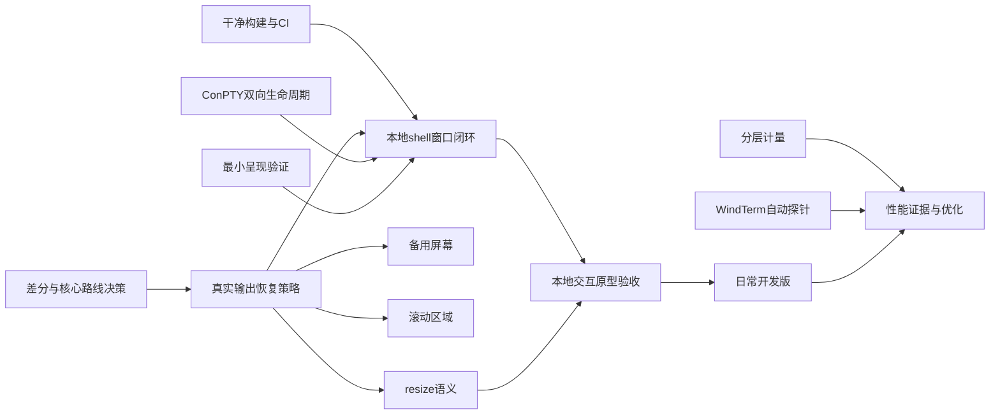

# 现状、目标差距与下一阶段任务

盘点及第一批：2026-10-22；第二至四批更新：2026-10-23。盘点基点：`6618e65`，第一批从 `acc38c3`、第二批从 `51b50ef`、第三批从 `a559541`、第四批从 `8e77b0d` 开始实施。第四批已完成[独立审查](reviews/2026-10-23-c5.md)。本文件是当前执行计划，历史实验记录保持原样。任务标识用于本计划，不代表已经创建同编号的 GitHub issue。

## 判断

项目已经拥有自动研究和验证的基础、有限的终端状态核心，以及支持物理行缩放的本地 shell 交互原型；目前处在 **M0 未完成、M1 进行中** 的位置。还没有日常开发版，也没有足够证据量化与 WindTerm 的性能差距。不能把测试数、代码量或逆向函数数换算成产品完成百分比。

近期应把重心从持续扩展离线回放，转向一个可自动验收的本地交互终端。兼容性、性能证据和工程化并行推进；不等待恢复 WindTerm 私有源码，不要求用户补跑已停止的手工校准。

## 已有证据与目标距离

| 目标维度 | 已有能力 | 主要缺口 | 当前判断 |
|---|---|---|---|
| 独立完整开源 | 原创实验源码、MIT 许可、Unicode 数据许可、构建命令、可核验结果 | 尚无完整产品构建与发行；未来依赖和资源仍需逐项可获得 | 已建立来源边界，未交付完整产品 |
| 终端正确性 | UTF-8 标量、固定宽度策略、有限组合标记、基础 SGR、光标/擦除、有界物理行历史、逐检查点差分、显式有界 Recovery 模式 | 六类差异裁决、备用屏幕、滚动区、输入/查询回复、逻辑行 reflow、完整文字布局 | 有限子集实验 |
| 本地终端 | 真实 cmd → ConPTY → 有界队列 → Recovery → HWND，基础输入/中文消息/退格/方向键/Ctrl-C/resize/退出回收 | 逻辑行 reflow、实际呈现、通用文字布局、IME、选择/复制/粘贴 | 已形成可缩放的受限闭环 |
| 远程日常工作 | 功能矩阵和协议边界 | SSH 认证/主机身份/会话、SFTP、断线取消、代理跳板、凭据存储 | 未实现 |
| WindTerm 级性能 | 固定官方 2.7.0 身份；静态接收路径；120 次机制实验；资源与观测工具 | 受控正式基线、实际呈现和输入延迟、长时分层成本、大历史、多会话公平性 | 差距未知，不能判定接近或落后多少 |
| 易维护与可发布 | 根 CMake、Windows/Linux 核心构建、CI workflow、固定差分依赖、合成失败复现 | 产品构建、模糊测试、依赖升级策略、安装包、干净机器产品验证 | 实验具备跨平台回归入口 |

盘点时的历史基点：66 项测试通过，当时 workflow 数为 0。第一批当前验证与新增结果见下表；不把历史测试数当作产品完成比例。

关键限制来自实际实现：默认研究严格模式遇不支持输入仍抛异常，A1 显式选择恢复模式；屏幕每格使用字符串，滚动会搬移行；参考差分仅覆盖共同子集。A1/C5 连接了可缩放 shell 回路，但复杂控制、逻辑行 reflow、输入法和大历史尚未整合。这些是当前实现/实验策略，不是已经测出的性能故障。

## 第一批执行状态

| 任务 | 本轮交付与验证 | 剩余边界 |
|---|---|---|
| E1 完成现代 Windows/Linux 实验验收 | 根构建、显式二进制路径、固定 Actions 版本、干净检出 CI；初次本机 82 项测试/34 次回放，WSL 63 通过/5 跳过/10 次回放；审查新增 1 项路径回归通过。Server 2025 与 Ubuntu 远端均完成全套测试和回放 | Server 2022 的 T1 资源门槛未过，独立保留严格探针；没有产品安装包 |
| C1 完成受限验收 | pyte 0.8.2 / wcwidth 0.2.13 固定版本与哈希；95 次运行、1011 检查点；65 次共同子集一致、30 次精确复现 6 类差异；[ADR-0003](adr/0003-core-reference-and-reuse.md) | 临时保留自研用于实验/G1，产品选型未锁定；C6 前必须实际构建外部候选并重审 |
| T1 完成现代 Windows 受控子进程验收 | 无窗口 UTF-8 输入/回显、实际 resize、正常退出、大输出、含孙进程的取消/半途关闭、监督器超时；稳态句柄/线程检查及自有 Job 归零。修复旧 console 的 Unicode 读取差异 | Win11 首次增加 6 个句柄单列；Server 2022 稳态 +1 未解决，归属未知；真实 shell、通用输入队列、长时泄漏验证待做 |
| V1 已开始，未完成 | GDI/DirectWrite × 96/144 DPI，共 4 次离屏局部更新与全量绘制一致；合成位图可检查 | 真实窗口、光标、fallback、帧提交/呈现测量和后端 ADR 尚缺 |
| P1 已开始，未完成 | 24 次固定 ASCII 长批次、独立状态检查、计数开/关交错、CPU 门槛、分配及内存记录 | 波动较大；CPU 计量校准、解码/状态/历史归因、独立受控批次尚缺，不发布排名 |

以上为第一批交付时的状态；第二批结果见下表。C1 的六类差异保持可复现，按规范与产品策略逐项裁决。P2 仍是独立、有限的自动对照探针，不重新启动手工校准。

第一批还完成[规范/需求双轴审查](reviews/2026-10-22-first-batch.md)，修复差分程序错误回退旧构建的问题。[跨环境记录](research/conpty-platform-check-2026-10-22.md)保留 Server 2022 失败与现代环境验收边界；旧系统兼容性列入后续工程任务，不能在未解决前扩大平台声明。

## 第二批执行状态

| 任务 | 本轮交付与验证 | 剩余边界 |
|---|---|---|
| C2 完成有限核心恢复验收 | 显式 Recovery、未知 ESC/CSI/OSC/DCS 消费、UTF-8 替换、SGR 原子提交、EOF 清理；30 项恢复测试涵盖百万字节输入、任意字节与多种拆包。原有严格差分 95 次仍为 65 一致/30 精确已知差异 | 仅 7-bit ESC 编码；无回复和 OSC 副作用；未终止字符串一直丢弃至明确同步点；不是完整 VT |
| V1 完成固定场景受限验收 | 独立非输入桌面上的真实 HWND/WM_PAINT、只读快照、文字/颜色/真实光标、局部更新；GDI/DirectWrite × 96/144 逻辑缩放；实际字体审计与缺字负例；[ADR-0004](adr/0004-presentation-backend.md) 暂选 DirectWrite 用于 G1 | 实际窗口 DPI 为 96，未验证跨物理 DPI；GDI fallback 身份仍未知；HWND resize 不等于核心 resize/reflow；实际 presented 与无观测基线未知，不发布后端排名 |
| P1 完成计量校准修正，整体仍部分完成 | schema v2 使用连续长区间的一次 CPU 差值，低频门槛检查；顺序两批共 48 核心样本/4 校准通过，每个核心 CPU 区间至少 2 秒；失败输出与身份留存，旧结果不改写 | 两条调用路径总成本不能相减归因；仍缺解码/状态/历史分离、Unicode/大历史负载、无插桩构建与更严格环境控制 |

本机统一 Release 构建的 10 套 CTest（126 项）与 34 次完整状态回放已通过。一次窗口检查使用了新增字段前的旧 EXE，日志保留；重编译后该套 4 项通过。[双轴审查](reviews/2026-10-23-second-batch.md)两轴均无实质发现。详细样本及环境见[第二批验证记录](research/second-batch-2026-10-23.md)。

## 第三批：A1 固定网格 shell

已连接真实 cmd、ConPTY、256 KiB 输出队列、16 KiB 输入队列、Recovery 与共享 DirectWrite 窗口；UI 每次最多解析 64 KiB，并在 8 KiB 块间检查 4 ms 预算，以版本快照合并 dirty 行绘制。入口为 `termforge_shell.exe`，正常运行不输出或保存用户屏幕诊断。

自动验证普通命令、中文、退格/左右方向键、至少一秒持续输出后 Ctrl-C 与后续命令，再正常退出；另测输出中关闭和外部监督器超时回收。输入是脚本消息，状态/帧提交端点分开，实际呈现保持 null。共享绘制提取后保留 V1 检查，并修复偶发桌面切出 ERROR_BUSY：UI 线程退出后由父线程关闭 desktop。

交付范围与原始记录见[本地 shell 说明](../experiments/shell/README.md)及[第三批验证记录](research/third-batch-a1-2026-10-23.md)。该批只验收固定 80×24、本地 cmd 和基础输入，不含 IME、粘贴、全屏 TUI、SSH 或产品安装包。

## 第四批：C5 与 G1 基础验收

核心新增物理行 resize，窗口可缩放，独立 worker 合并 ConPTY 尺寸请求，UI 持续处理输出。行为、截断限制与同步边界见 [ADR-0005](adr/0005-physical-row-resize.md)。自动窗口场景由子进程查询实际尺寸，覆盖缩小、快速往返、洪流中缩放后的中断/退出，以及缩放中关闭；局部画面与全量重绘比较。

A1/C5 合流完成 G1 基础闭环：构建、启动、输入、输出、改变尺寸、退出。G1 不包含逻辑行 reflow、IME、复制粘贴或完整 TUI。验证记录见[第四批记录](research/fourth-batch-c5-2026-10-23.md)。原计划下一批为 C3/C4 与 U1；用户最新要求改为优先 UI 对齐，执行顺序见下节。S1 可独立推进，P1/P2 保持性能证据支线。

## 最新优先级：UI 对齐（2026-10-23）

采用发行物资源、定向反编译和自有运行时控件树交叉验证，截图用于最终复查。已完成官方 2.7.0 的第一批布局取证与两种逻辑尺寸测量，已验证全自动 fresh-profile 探测及进程回收；已交付 UI-A 首个 workspace 切片：实测初始层级布局、底部真实本地多标签、切换/关闭、侧栏显隐和焦点模式。UI-B 已加入五条分隔线拖动、Unicode 标签重命名及布局比例/显隐保存恢复；配置读取/替换和真实窗口的新进程恢复均可自动验证。主区本地标签、UI 字体、每会话文字缩放与受控 DPI 已接入；真实跨屏 DPI、文字兼容性、完整动作上下文和会话恢复尚待完成。操作和验证见[工作区说明](../experiments/shell/README.md)，早期范围与审查见 [UI-B 记录](reviews/2026-10-23-ui-b.md)。报告、地址、证据 ID 与已知缺口见 [UI 调查](research/windterm-ui-2026-10-23.md)。

| 顺序 | 工作 | 验收 |
|---|---|---|
| UI-A | 补测有主标签/显隐状态，独立实现层级布局与集中样式参数 | 同尺寸下矩形、比例与状态匹配；保留既有 shell/resize 回归 |
| UI-B | 已交付本地多标签、会话列表、关闭/切换/重命名、面板显隐/拖动及布局恢复；继续核对 WindTerm 动作上下文 | 两会话状态隔离、后台退出不打断重命名、拖动边界/取消、新进程布局恢复、进程回收已有回归；完整行为等价未验收 |
| UI-C | 几何/动作自动比较，再视觉复查 | 固定字体/DPI/窗口状态，误差与未对齐项显式记录 |

2026-10-23 [第二轮 UI 逆向](research/windterm-ui-typography-2026-10-23.md)：自动打开合成本地 cmd 主标签，默认缩放两次、Qt 1.5 倍一次，取得两种窗口尺寸的主区域几何及控件/文本绘制字体；先修正了首启导入宿主 SSH 元数据和遗漏 winpty-agent 的取证问题。

随后完成[主区本地会话切片](milestones/UI-main-local.md)：主区和底部各自维护选中会话，可同时运行真实 cmd；新建/关闭/重命名、跨区域焦点与后台退出已有自动场景。主区外框在 1360×860 / 2048×1120 按测量值比较，并独立查询实际子窗口及 ConPTY 尺寸。工作区私有加载随附的独立 OFL Roboto Mono，核实实际 face；终端字体和网格保留原行为。真实跨屏 DPI、逐字形 fallback、完整动作上下文、标签排序与会话恢复仍待验证。

C3/C4、U1 和性能验证仍是日常可用门槛。此调整不锁定产品 GUI 框架，不复制 WindTerm 私有实现或资源，不将 UI 相似度换算成性能或产品完成比例。

随后完成 [DPI / 文字缩放切片](milestones/UI-dpi-zoom.md)：会话比例独立保留于当前生命周期，支持 50%–200% / 25% 步长；单元像素先取整再用于文字/裁剪/光标，DPI 与最终子窗口尺寸一起更新，避免临时缩窄丢字。三个真实会话在 96→144→192→96 受控消息中验证隐藏传播、101 字符长行保持、同网格重绘、物理边缘命中、重命名及拖动；真实跨显示器仍未验收。当前下一批优先选择/复制/粘贴与历史浏览（U1），并行保留真实跨屏验证和 C3/C4 兼容性，不继续把空布局区域算成功能完成。

## 收敛到三个可见交付关卡

| 关卡 | 用户能做什么 | 必须具备的验收证据 |
|---|---|---|
| G1 本地交互原型 | 从源码构建，打开本地 shell，输入命令、看到正确输出，改变窗口尺寸并退出 | 自动 shell 场景、生命周期、画面/状态验证、基础输入；持续输出时仍响应。完整终端兼容性不在此处冒领 |
| G2 Windows 日常开发版 | 本地终端和 SSH、基本会话/标签、中文输入、复制粘贴、历史搜索及基础 SFTP | 常用真实任务回归、错误恢复、连接身份与凭据处理、干净环境安装、持续运行与资源回收 |
| G3 有证据的性能目标 | 在明确的共同功能与配置下接近 WindTerm 的吞吐、响应、内存和稳定性 | 同负载/正确性/端点、重复样本与波动、工具扰动、历史/交互/多会话/长时数据；逐场景判断，不以单项跑分代表全部 |

G2 不需要等待 G3 全部结束；G3 的测量和改进从现在开始贯穿 G1/G2。高级补全/折叠、串口、X11、复杂协议、跨平台产品化放在 G2 以后，不能拖住本地闭环。

## 近期可直接执行的任务

下列是任务切片；“依赖”指完成验收所需的前置条件。设计/调查可提前进行。所有入口默认无交互、保留失败、有超时；需要真实桌面或外部服务时由实验环境提供，不转交用户逐轮操作。

| ID / 优先级 | 交付 | 依赖 | 验收条件 |
|---|---|---|---|
| E1 / P0 | 干净检出能构建和回归 | 无 | 将无平台 API 的核心/replay 独立构建；Windows transport 条件构建；测试接收二进制路径；Windows CI 执行核心与接收测试，Linux CI 至少构建/测试核心；失败产物可下载，私有/local 数据不上传 |
| C1 / P0 | 参考核心差分与自研/复用决策 | 无 | 固定至少一个许可明确的开源参考版本；在共同子集上比较中间状态、最终状态和随机非均匀拆包；失败给出最早差异与可复现输入；记录宽度等策略差异。用同一套回放评估继续自研与复用核心的兼容性、维护负担和测量接口，提交可重审 ADR，不凭 C++ 标签选型 |
| T1 / P0 | 无窗口 ConPTY 双向运行与回收 | 无 | 启动自有受控子进程，自动输入/回显、resize、正常退出、取消/半途关闭、大输出；检查字节与退出状态、句柄/线程/子进程回收；只管理本任务进程。此任务可先用原始字节验证，不依赖解析器兼容所有 shell 输出 |
| V1 / P0 | 固定屏幕场景能被画出并自动核验 | 无 | 使用现有状态快照，限定窗口验证 ASCII/中文/组合标记/颜色/光标、DPI 和局部更新；固定场景可捕获并检查；记录绘制/帧提交成本与采样误差。在有限候选间形成呈现后端 ADR；不先建设完整应用框架 |
| P1 / P0 | 自有核心的可信分层计量 | 无 | 固定输入、状态/历史摘要、代码和工具身份；延长批次直到 CPU 时间可区分，分离准备/接收/解析与状态/呈现（未有则 null）；重复与顺序控制、失败保留、观测开销对照；测量内存/分配，不把队列时间称为输入或呈现延迟 |
| C2 / P0 | 真实输出不会因未知序列终止会话 | C1 | 保留研究严格模式；为产品路径定义未知 ESC/CSI/OSC/DCS、非法 UTF-8、截断和超长输入的消费/恢复策略；后续合法文本可继续处理，序列体不误作可执行回复或普通文本，缓存有界；差分与负面用例通过 |
| A1 / P0 | 最小本地 shell 窗口闭环 | E1、T1、V1、C2 | 独立入口启动/关闭本地 shell，输入普通命令、回显、Ctrl-C、持续输出；状态提交与绘制之间有一致性边界和有界调度；自动重复启动/运行/关闭无残留；键盘到状态/帧端点分开记录，未知呈现端点保留未知 |
| C3 / P1 | 备用屏幕往返保持主屏 | C2 | 进入备用屏幕、写入、退出后恢复主屏及约定光标/样式；备用屏不污染主历史；重复切换和分块差分通过；这是独立状态场景，不依赖完成 GUI |
| C4 / P1 | 局部滚动只影响指定区域 | C2 | 明确上下边界、原点/自动换行及光标保存恢复；区域外内容和历史不被错误修改；中间状态差分通过。若所选核心已提供则交付适配与验证，不重复实现 |
| C5 / P1 | resize 保持定义好的内容与坐标 | C2、T1 | 固定软/硬换行、截断/保留/重排、宽字符边界和历史规则；反复缩放与 1 列边界有用例；通过 T1 自动验证进程尺寸与状态尺寸一致；窗口层集成在 G1 验收，备用屏/滚动区交叉用例归 C6，不阻塞基础 resize |
| P2 / P1 | WindTerm 自动对照可行性探针 | 无 | 固定官方 EXE/独立配置/自有数据源，连续两次自动建立测试会话、收集身份与实际可观测端点并清理；先只做有限探针。失败形成明确证据缺口，不扩大手动流程，也不阻塞 A1 |

C1 应尽早完成，避免在没有维护成本判断的情况下不断扩写自研解析器。当前自研核心可以继续作为独立机制实验和测试资产；复用开源组件仍符合“完整开源”，前提是源码、许可、构建和依赖可获得。

### 第一批与依赖关系

第一批可并行开展 E1、C1、T1；V1 和 P1 使用现有快照/数据也可独立开始。主线是 C1 → C2，与 T1、V1 合流后完成 A1。C3/C4 不阻塞“普通命令可交互”的第一次演示，但会阻塞全屏 TUI 支持声明；C5 是 G1 完整验收条件。

## G1 之后的任务包

这些是后续工作包，不伪装成一次即可完成的小任务。进入执行前再按验证场景拆小；选型、接口和实际成本明确后才承诺工期。

| 工作包 | 主要前置 | 可见交付与关键验收 |
|---|---|---|
| U1 日常输入/文字 | A1，C5 | 中文 IME、按键模式、粘贴、选择复制、字体 fallback/字素策略；中文编辑与宽字符选择结果正确，输入法状态不因输出刷新丢失 |
| C6 常用 TUI 与回复 | C3、C4、C5、T1 | 按真实应用轨迹补查询响应、插删、模式及必要样式，加入备用屏/滚动区/resize 交叉用例；固定 shell/分页器/编辑器可进入、操作、退出恢复；明确支持矩阵而非泛称完整 VT |
| H1 历史浏览、搜索与规模实验 | P1，C5 的坐标语义 | 基础浏览/搜索先在有界历史上验收，纳入 G2；再扩展 1/10/100 万行的内存、滚动、搜索和淘汰，对比紧凑格/行环/块历史。百万行性能达标不作为首版日常使用前置，内容与查询结果始终正确 |
| S1 SSH 会话 | T1 形成的传输边界 | 维护中的开源协议库接入；以原始字节与本地受控服务自动测试认证、主机身份、输入/输出/resize、取消和断线，不等 C6。窗口整合依赖 A1，TUI 兼容整合依赖 C6；网络与终端成本分开。库/许可调查可提前并行 |
| S2 SFTP 文件任务 | S1 | 上传/下载哈希、批量队列、取消、失败重试和覆盖策略，传输时终端仍能交互；不把库暴露接口当成功能完成 |
| W1 会话管理与公平调度 | 本地：A1、P1；SSH 整合另依赖 S1 | 本地/SSH 多会话、标签/基础分屏、配置与安全凭据保存；前台输入不被后台高输出饿死，关闭只回收对应会话；先小规模再覆盖 1/5/20 会话 |
| R1 可安装日常开发版 | E1、U1、C6、S1、基础 H1/S2/W1 | 干净机器构建与安装、依赖许可/来源、配置迁移与卸载边界；持续运行和反复开关会话后资源稳定，用户可从源码复建同一功能集 |
| P3 正式性能对照与优化 | P1、可观测的 P2、G1；扩展场景依赖相应功能 | 统一配置、正确性、完成端点和采样扰动；先覆盖纯文本/Unicode/交互，再历史/多会话/长时；两批重复结果与误差。对照仍不可自动化时只报告自有回归结果，不宣称追平 |

## 逆向的位置与退出条件

保留已验证的无界面索引工具；下一步不做“完整反编译工程”。当 P1/H1/V1 测量暴露无法解释的瓶颈时，才提出具体问题，例如历史压缩块与缓存边界、消费调度、可见区域更新节奏。

每次研究须输出：静态/动态事实、尚未验证的推断、一个原创可比较实验。证据不能改变设计选择或解释测量时，结束该分支。私有反编译、资源与二进制仍只保留本地。逆向不是 ConPTY、CI、SSH/SFTP、基础交互这些明确工程任务的前置条件。

## 现有 GitHub 任务如何衔接

- #1/#2 已关闭：协议设计与生成器已交付，不等于协议的全部场景已运行。
- #3 仍开放：工具已有较多实现；剩余端点和扰动问题由 P1/P2/P3 继续覆盖。
- #4 仍开放：正式 WindTerm 基线未完成，不能用自有机制实验关闭。
- #5 仍开放：v0.2 已覆盖其首个自动实验和有限核心规格的一部分；需要审查剩余 ADR/架构决策后再结项，而不是长期把所有产品任务塞进此 issue。

本次盘点不修改上述 issue 状态，也不创建大量远期占位 issue。详细切片以本文件为当前地图；执行某一切片时再将其验收条件放入跟踪任务，避免路线图和 issue 双份长期漂移。

## 证据入口

- [核心 v0.2 支持与限制](../experiments/core/README.md)、[当前单元格模型](../experiments/core/screen.hpp)、[解析器](../experiments/core/terminal.hpp)
- [接收机制与结果](research/receive-experiment-2026-10-22.md)、[无界面逆向观察](research/windterm-headless-2026-10-22.md)
- [正式基准协议](../benchmarks/PROTOCOL.md)、[真实 WindTerm 烟测及未知端点](../benchmarks/results/2026-10-21-windterm-smoke/summary.json)
- [自动执行原则](adr/0002-automation-first-investigation.md)、[来源规则](PROVENANCE.md)
- 实施时核对的原始规范：[Microsoft ConPTY 会话创建与生命周期](https://learn.microsoft.com/en-us/windows/console/creating-a-pseudoconsole-session)、[XTerm 控制序列](https://invisible-island.net/xterm/ctlseqs/ctlseqs.html)、[Unicode East Asian Width](https://www.unicode.org/reports/tr11/)。这些规范说明接口与语义，不证明本项目已实现或达到性能目标。
