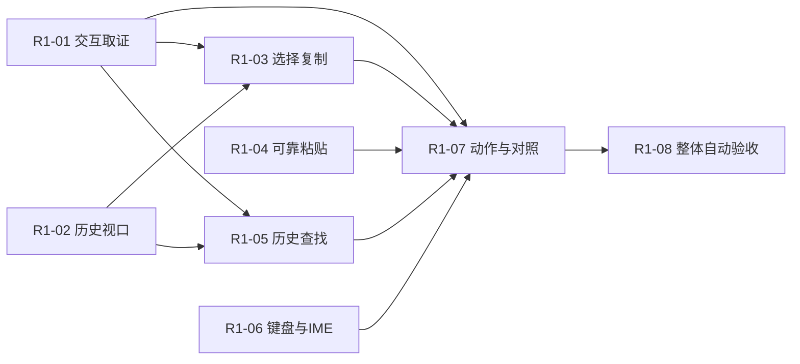

# R1：基础文字交互复刻

目标：用户在两个区域的真实本地会话中完成“输出日志 → 回看历史 → 查找 → 选择复制 → 粘贴 → 中文输入 → 切换/缩放 → 退出”。这是一条能完整操作的工作流，不以增加菜单或空面板计完成。

基点：`2dc8d6d` 已交付受限 cmd 工作区和受控 DPI。以下八个切片按各自合同验收；模块或窗口接入存在不等于整项完成。现状见 [FEATURES](../FEATURES.md)，GitHub 编号及实时状态见 [TRACKING](../TRACKING.md)。本文件维护交付合同，不累计开发进度。

## 范围和实施顺序

沿用核心与呈现分离的方向，R1 接口须保留替换空间；目前尚未通过实际替换验证核心接口。沿用物理行 resize，不在 R1 隐式承诺 reflow。基础历史浏览不依赖完整性能归因；输入队列保持有界。基础实现和取证可并行，最终对照必须等 R1-01 行为契约；明确的独立实现策略不冒充 WindTerm 已测行为。

历史身份、内容版本、文本投影和视口是可独立验证的行为合同；UI 不直接持有可变核心行的引用。R1 可以在现有核心上验证这些合同，但不据此跳过 R2 的外部核心比较，也不预先要求候选复刻当前内部容器。

| 切片 | 交付 | 阻塞 |
|---|---|---|
| R1-01 | 冻结 WindTerm 2.7.0 基础文字交互契约 | 无，可先执行 |
| R1-02 | 浏览有界历史并保持每会话阅读位置 | 无，可先执行 |
| R1-03 | 选择屏幕与历史文字并精确复制 | R1-01, R1-02 |
| R1-04 | 将大段 Unicode 文本可靠、可取消地粘贴到目标会话 | 无，可先执行 |
| R1-05 | 在有界历史中查找、跳转和取消搜索 | R1-01, R1-02 |
| R1-06 | 基础键盘与中文 IME 完整输入闭环 | 无，可先执行 |
| R1-07 | 统一文字动作上下文并完成 WindTerm 交互对照 | R1-01, R1-03, R1-04, R1-05, R1-06 |
| R1-08 | 验收完整文字工作流与多会话资源边界 | R1-07 |

表中是固定依赖关系；已验收项保留为回归基础，不重新开工。当前接续顺序见 [TRACKING](../TRACKING.md#从当前状态接着做)，每项实时状态和收尾清单见 issue。下面的复选框描述合同，实际验收记录只在 issue 维护。并行工作按接口边界分配，避免同时改同一窗口入口。

## R1-01 · 冻结 WindTerm 2.7.0 基础文字交互契约

把下一阶段要复刻的行为转为有来源、可回放的验收场景，避免按截图和默认习惯猜操作。

**具体事项**

1. 固定官方包/EXE 哈希及 fresh profile，使用自生成编号行、宽字符、组合字符、软硬换行和多行输入。
2. 观察历史暂停/跟随、选择单位、复制换行/尾空白、粘贴确认与入口、查找范围、快捷键和编辑控件焦点；需要时定向检查资源、调用路径和运行状态。
3. 每条记录已观察、仅静态声明或未知，附输入/动作/配置和证据；将需要实现的状态转移写成原创契约与 fixtures。
4. 分别实际触发复制、粘贴、全选和查找的目标菜单入口；菜单可见不等于动作已验证。把软换行、硬换行、尾空白和 Unicode 的选择结果与真实 CF_UNICODETEXT 分开观察。
5. 粘贴以动作前接收端字节为基线，检查确认前、取消后、确认后和弹窗关闭。单行直接发送与多行确认分别建模；先发出文本再按 Escape 不能命名为成功取消。

**验收**

- [ ] 两次无人值守新配置运行产生可比较的行为记录，目标和自有进程均正常回收。
- [ ] 上述基础操作的核心语义有直接证据；未观察项显式挂到任务，不得用推断关闭。
- [ ] 公开内容只有原创场景与事实摘要，不提交二进制、私有资源、反编译或个人配置。

**边界：** 只调查 R1 操作；复杂补全、正则查找、协议、完整设置不在本切片。若探针不可行，记录具体阻塞并推进其他独立任务，不转交用户逐轮操作。

## R1-02 · 浏览有界历史并保持每会话阅读位置

输出超过窗口后仍能滚轮/翻页/拖滚动条回看，新增输出不会拉走阅读位置，可明确回到底部。

**具体事项**

1. 为保留行提供稳定身份与内容版本，分离 history/live screen/viewport，扩展只含可见屏的快照接口；同一 live 行被 CR/擦除/覆盖时版本变化，移入历史保留身份，淘汰后不复用身份。
2. 定义保留上限、淘汰后的锚点、空历史、宽字符、resize/zoom 和关闭规则；区分实际自动换行、显式换行、刚写满但尚未换行、resize 裁剪，不能仅凭满列推断软换行。保留复制/查找共用文本投影所需元数据；软换行后回写原行的空列时，投影不能遗漏实际显示的新增字符。
3. 连接滚轮、翻页、滚动条、跟随状态与回到底部动作；每个会话独立保存视口，不触碰输入焦点。
4. 为后续选择/搜索提供只读文本投影和稳定位置，不向 UI 暴露可变 `Screen` 容器地址或单元格引用；当前核心与未来候选可分别适配该行为合同。

**验收**

- [ ] 真实 cmd 输出带编号的多屏内容，独立预期验证前后翻页、隐藏会话、新增输出和回到底部。
- [ ] 历史淘汰、连续 resize/zoom 不悬空引用，不显示错误会话的数据；保留容量可检查且不会无界增长。
- [ ] 自动化同时核对可见行内容、滚动范围和最终回收；不只看滚动条是否移动。
- [ ] 视口与文本消费者使用只读投影及稳定位置，内容版本变化与淘汰不会留下可变核心行引用；不以本切片宣称已验证外部核心替换。

**边界：** 先完成有界历史可用性，不等待百万行性能或 P1 全部分层；沿用物理行 resize，裁剪限制继续明示，逻辑行 reflow 在 R2。R1-07 再按 R1-01 完成精确交互对照。

## R1-03 · 选择屏幕与历史文字并精确复制

用户在终端拖选、按契约选词/选行及跨历史选择，通过菜单和快捷键复制正确 Unicode 文本。

**具体事项**

1. 用稳定行/列坐标保存选区，渲染高亮独立于屏幕状态，拖出可见区能有界自动滚动。
2. 处理宽字符续格、组合字符、反向选择、跨行、空白和软硬换行；缩放后仍对应同一文本。可变 live 行内容版本变化时明确更新/失效选区，不复制已被覆盖的旧字符。
3. 接系统 Unicode 剪贴板，明确复制空选区、权限/占用失败、重命名框和其他会话的上下文。
4. 准备自有隔离 window station 或专用测试环境，先验证系统剪贴板往返与回收；单独创建 desktop 不等于隔离剪贴板。

**验收**

- [ ] 独立预期文本与实际系统剪贴板往返逐字比较，包括中文、组合标记、尾空白和多行。
- [ ] 持续输出、历史淘汰、DPI/zoom、切换标签、关闭会话均不复制串行或悬空内容。
- [ ] 系统剪贴板测试使用自有隔离 window station 或受控环境，不覆盖用户剪贴板；测试替身不能代替系统 API 验收。

**边界：** 矩形选择等只有 R1 契约明确纳入时才在本切片交付；其他选择模式列入 R4，不能悄悄标完整。

## R1-04 · 将大段 Unicode 文本可靠、可取消地粘贴到目标会话

剪贴板文本进入当前会话时不丢尾、不阻塞 UI，切换标签不会把后半段发给另一个会话。

**具体事项**

1. 定义 UTF-16/UTF-8、CR/LF、控制字符、空文本与多行提示策略；动作开始时绑定目标会话。
2. 先检查剪贴板文本长度并定义总内存上限及超限拒绝/分批策略；按现有 16 KiB 输入队列与单消息 1 KiB 边界实现分块/背压和取消，区分已接受、已发送、失败。不能先复制无限文本再称队列有界。
3. 连接菜单/快捷键与错误提示，关闭中取消任务；R1-07 对照目标行为调整默认交互。
4. 复用隔离 window station 或专用测试环境准备系统剪贴板和真实接收端；探针先验证隔离与清理，再执行大文本、占用和取消场景。
5. 经产品 Paste 动作验证读取失败：实际占用、超限时退出忙碌，无确认框、无发送、当前会话有错误反馈，并能成功重试。底层 API 拒绝不能代替窗口工作流。
6. 用延迟渲染 owner 的握手确认读取尚未完成，再在产品窗口取消或关闭目标；验证 UI 仍响应、helper 回收、无迟到粘贴、无 Escape 泄漏，其他会话可继续输入。读取阶段与发送阶段分别验收。
7. 对畸形剪贴板 fixture 保存交给系统前和读回后的字节/分配边界，区分系统转换、夹具假设和读取器行为；有界文本解析仍须独立覆盖缺少终止符，不能把一次夹具失败直接归因于产品或改成跳过。

**验收**

- [ ] 受控真实子进程接收大于队列容量的合成文本，按字节数/哈希验证无丢失、无重排；不执行不受控粘贴命令。
- [ ] 覆盖换行、Unicode、剪贴板占用、超限、取消、目标关闭、切换会话及输出洪流；取消后子进程只收到已声明发送的完整前缀，不能有隐藏尾部或重排。
- [ ] 粘贴期间 UI 保持处理消息、队列和暂存有界；测试使用隔离系统剪贴板环境。

**边界：** 不假装支持 bracketed paste：若本切片纳入，必须同时实现模式启停和字节验收；否则明确归入 R2 输入模式，不能无条件添加包装序列。

## R1-05 · 在有界历史中查找、跳转和取消搜索

用户在当前会话打开查找框，按文字查找并前后跳转；后台继续输出时仍可使用终端。

**具体事项**

1. 限定首版 Unicode 字面量范围、大小写选项、查找方向、循环提示与当前命中；保留命中到稳定历史位置映射，复制与查找共用软硬换行文本投影，确有差异须依据 R1-01 说明。
2. 搜索分批执行并可取消/替换查询，结果数量有上限；处理输出追加、同一 live 行 CR/擦除/覆盖后的内容版本变化、历史淘汰和会话结束。
3. 命中高亮与选择相互独立，搜索框/重命名/终端焦点和 Escape 行为明确。

**验收**

- [ ] 独立 oracle 检查中文、重复、无结果、边界与淘汰后的命中，跳转显示准确行。
- [ ] 持续输出和新查询使过期结果失效，取消后不回写旧会话，前台仍处理输入。
- [ ] 检查结果/工作量边界及关闭回收，不依赖读取全部无限历史。

**边界：** 正则、搜索预览、跨会话和百万行性能属于 R4；R1 的字面量与换行范围必须公开。

## R1-06 · 基础键盘与中文 IME 完整输入闭环

终端能接收基础编辑按键和中文输入法提交，候选窗口跟随光标；工作区快捷键与编辑控件互不抢键。

**具体事项**

1. 固定系统输入法名称/版本和受控交互环境，先验证能自动驱动真实组合、观察候选 UI 与接收提交结果；环境缺口记录为未验收项，继续可独立实现的键盘/输入合同，不转交用户反复操作。
2. 明确普通键、修饰键、Home/End/Delete/Tab 与 UI 动作优先级，保留现有方向键/Ctrl-C。
3. 处理 IME composition、候选定位、提交、取消和失焦；使用当前物理网格定位，不将预编辑文字提前发给子进程。
4. 覆盖输出刷新、标签切换、现有 rename、resize/DPI/zoom 和关闭；历史阅读/新增 find 的交叉整合在 R1-07/08，记录基础输入与后续应用键盘模式的边界。
5. 环境预检先固定实际 runner/OS、输入法和语言能力，逐操作保存开始/结束/耗时/错误，查询有超时与自有进程回收；调查成功、环境准备成功、真实 IME 探针通过、产品窗口通过是四个不同结果。预检不能因枚举成功就宣称输入法就绪。

**验收**

- [ ] 合成消息与受控子进程按字节检查提交内容，无重复、丢字、错误控制序列。
- [ ] 固定输入法名称/版本及 Windows 环境，自动验证实际系统 IME 的组合、取消、真实候选 UI 位置和提交；仅 WM_CHAR 或检查传入坐标不能结项。
- [ ] 切换焦点和关闭不会将组合文字发给另一会话；候选定位和缩放范围有实际检查。
- [ ] 每次输入法探针使用独立证据目录；拒绝复用已有目录且保留原失败内容，超时与清理结果同样留存。

**边界：** 复杂 emoji、全字素整形、应用键盘模式与所有第三方输入法属于 R2/后续矩阵；测试环境缺口必须保持开放，不能转为用户反复手工操作。

## R1-07 · 统一文字动作上下文并完成 WindTerm 交互对照

鼠标、菜单和快捷键执行同一动作，在两区域会话、查找和重命名状态下目标、启用条件及反馈一致。

**具体事项**

1. 将复制/粘贴/查找/回到底部等动作统一到焦点上下文，明确无选区、无会话、忙碌、关闭中行为。
2. 按 R1-01 逐项核对默认键位、鼠标与状态转移，调整实现；TermForge 自定策略单列，不冒充参考行为。
3. 检查文字、选区、光标和命中在现有受控 DPI/zoom 下保持一致，保留原有多标签/分隔线/编辑焦点回归。

**验收**

- [ ] 每个基础动作覆盖契约规定的菜单、快捷键及鼠标入口，并检查输入只到目标会话；不强加参考没有的入口。
- [ ] 对照表能从观察证据找到实现和测试；未知基础动作仍开放，差异有明确处置。
- [ ] 无会话/重命名/查找/历史阅读/关闭中的交叉场景通过，既有工作区行为无回退。

**边界：** 完整菜单、标签拖放、任意分屏、完整设置和真实跨屏验收归 R2/R4，R1 不做空壳按钮。

## R1-08 · 验收完整文字工作流与多会话资源边界

从启动到关闭自动演示整条文字工作流，并让未来每次改动都能重复验证。

**具体事项**

1. 构建“编号日志→历史浏览→查找→选择复制→粘贴→中文输入→切换会话/缩放→退出”真实进程场景。
2. 在现有 8 会话范围内加入后台洪流、前台操作、历史淘汰、取消与反复创建/关闭；固定负载和运行时长，保留全部失败。
3. 把场景接入 Windows CI/受控系统输入环境，安装声明的测试依赖，在最终源码上重新构建并运行完整回归，更新能力和差异矩阵；局部旧构建通过或系统用例 skip 不能解锁整项验收。记录 CPU/内存/操作到状态与绘制提交端点，禁止代替实际呈现。

**验收**

- [ ] 独立内容 oracle、系统剪贴板往返、真实子进程字节及实际 HWND 共同验证，不只依赖内部成功标志。
- [ ] 队列/历史/搜索/粘贴缓存有界，自有 Job、desktop 和任务回收；区分初始化增长与长期趋势。
- [ ] R1-01–07 全部满足限定契约；公开复现入口/配置/结果与剩余差异，没有要求用户逐轮点击。

**边界：** 此路标交付基础本地文字交互，不宣布常用 TUI、SSH、百万行性能或 WindTerm 全部行为等价；产品包和长时平台发布门槛在 R2–R5。

## 路标关闭条件

所有切片及核心行为证据完成，两个区域和隐藏会话交叉场景通过；关键行为无未解释差异；真实系统 IME/剪贴板验收不能用合成消息替代。硬件/环境缺口仍是缺口，不能因为自动化不方便而标通过。

性能工作从本路标开始记录可复现自有回归与成本；正式 WindTerm 对照仍由 #3/#4 持续推进。没有共同功能/配置/正确性/端点与观测扰动证据前，不设虚假的“已追平”百分比。

R2 承接完整 TUI、实际核心候选与 ADR 重审、PowerShell/WSL、会话/设置恢复、真实跨屏 DPI 和 Windows 开发包。远期范围与完整复刻定义见 [PLAN](../PLAN.md)。
