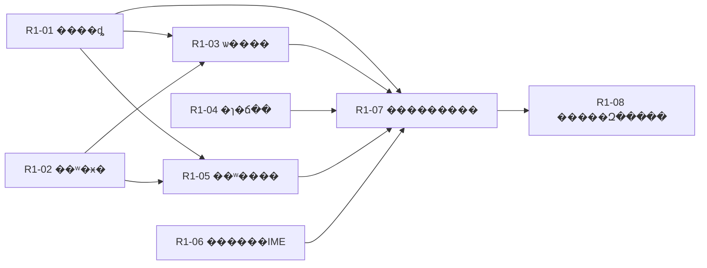

# R1���������ֽ�������

Ŀ�꣺�û��������������ʵ���ػỰ����ɡ������־ �� �ؿ���ʷ �� ���� �� ѡ���� �� ճ�� �� �������� �� �л�/���� �� �˳���������һ�������������Ĺ��������������Ӳ˵����������ɡ�

���㣺`2dc8d6d` �ѽ������� cmd ���������ܿ� DPI�����°˸���Ƭ����δ������գ�����ģ��ʹ��ڽ������п���ʵ�֣����ܾݴ˽�������������״�� [FEATURES](../FEATURES.md)��GitHub ��ż�ʵʱ״̬�� [TRACKING](../TRACKING.md)�����ļ�ά��������ͬ�����ۼƿ������ȡ�

## ��Χ��ʵʩ˳��

���ú�������ַ���ķ���R1 �ӿ��뱣���滻�ռ䣻Ŀǰ��δͨ��ʵ���滻��֤���Ľӿڡ����������� resize������ R1 ��ʽ��ŵ reflow��������ʷ����������������ܹ���������б����н硣����ʵ�ֺ�ȡ֤�ɲ��У����ն��ձ���� R1-01 ��Ϊ��Լ����ȷ�Ķ���ʵ�ֲ��Բ�ð�� WindTerm �Ѳ���Ϊ��

��ʷ���ݡ����ݰ汾���ı�ͶӰ���ӿ��ǿɶ�����֤����Ϊ��ͬ��UI ��ֱ�ӳ��пɱ�����е����á�R1 ���������к�������֤��Щ��ͬ�������ݴ����� R2 ���ⲿ���ıȽϣ�Ҳ��Ԥ��Ҫ���ѡ���̵�ǰ�ڲ�������

| ��Ƭ | ���� | ���� |
|---|---|---|
| R1-01 | ���� WindTerm 2.7.0 �������ֽ�����Լ | �ޣ�����ִ�� |
| R1-02 | ����н���ʷ������ÿ�Ự�Ķ�λ�� | �ޣ�����ִ�� |
| R1-03 | ѡ����Ļ����ʷ���ֲ���ȷ���� | R1-01, R1-02 |
| R1-04 | ����� Unicode �ı��ɿ�����ȡ����ճ����Ŀ��Ự | �ޣ�����ִ�� |
| R1-05 | ���н���ʷ�в��ҡ���ת��ȡ������ | R1-01, R1-02 |
| R1-06 | �������������� IME ��������ջ� | �ޣ�����ִ�� |
| R1-07 | ͳһ���ֶ��������IJ���� WindTerm �������� | R1-01, R1-03, R1-04, R1-05, R1-06 |
| R1-08 | �����������ֹ��������Ự��Դ�߽� | R1-07 |

�����ɲ��У�R1-01��R1-02��R1-04��R1-06���Ȱ���ʷ�ӿں�����������ɿ���֤��Ƭ��������������ǵ�ѡ��/���ҺͶ������ϡ���Ҫ������ͬʱ�����໥���ǵ��ļ��ϣ��г�ͻʱ���ӿڱ߽簲�Ŵ��к��롣

## R1-01 �� ���� WindTerm 2.7.0 �������ֽ�����Լ

����һ�׶�Ҫ���̵���ΪתΪ����Դ���ɻطŵ����ճ��������ⰴ��ͼ��Ĭ��ϰ�߲²�����

**��������**

1. �̶��ٷ���/EXE ��ϣ�� fresh profile��ʹ�������ɱ���С����ַ�������ַ�����Ӳ���кͶ������롣
2. �۲���ʷ��ͣ/���桢ѡ��λ�����ƻ���/β�հס�ճ��ȷ������ڡ����ҷ�Χ����ݼ��ͱ༭�ؼ����㣻��Ҫʱ��������Դ������·��������״̬��
3. ÿ����¼�ѹ۲졢����̬������δ֪��������/����/���ú�֤�ݣ�����Ҫʵ�ֵ�״̬ת��д��ԭ����Լ�� fixtures��

**����**

- [ ] ��������ֵ�����������в����ɱȽϵ���Ϊ��¼��Ŀ������н��̾��������ա�
- [ ] �������������ĺ���������ֱ��֤�ݣ�δ�۲�����ʽ�ҵ����񣬲������ƶϹرա�
- [ ] ��������ֻ��ԭ����������ʵժҪ�����ύ�����ơ�˽����Դ���������������á�

**�߽磺** ֻ���� R1 ���������Ӳ�ȫ��������ҡ�Э�顢�������ò��ڱ���Ƭ����̽�벻���У���¼�����������ƽ������������񣬲�ת���û����ֲ�����

## R1-02 �� ����н���ʷ������ÿ�Ự�Ķ�λ��

����������ں����ܹ���/��ҳ/�Ϲ������ؿ�������������������Ķ�λ�ã�����ȷ�ص��ײ���

**��������**

1. Ϊ�������ṩ�ȶ����������ݰ汾������ history/live screen/viewport����չֻ���ɼ����Ŀ��սӿڣ�ͬһ live �б� CR/����/����ʱ�汾�仯��������ʷ�������ݣ���̭�󲻸������ݡ�
2. ���屣�����ޡ���̭���ê�㡢����ʷ�����ַ���resize/zoom �͹رչ�������ʵ���Զ����С���ʽ���С���д������δ���С�resize �ü������ܽ�ƾ�����ƶ������С���������/���ҹ����ı�ͶӰ����Ԫ���ݣ������к��дԭ�еĿ���ʱ��ͶӰ������©ʵ����ʾ�������ַ���
3. ���ӹ��֡���ҳ��������������״̬��ص��ײ�������ÿ���Ự���������ӿڣ����������뽹�㡣
4. Ϊ����ѡ��/�����ṩֻ���ı�ͶӰ���ȶ�λ�ã����� UI ��¶�ɱ� `Screen` ������ַ��Ԫ�����ã���ǰ������δ����ѡ�ɷֱ��������Ϊ��ͬ��

**����**

- [ ] ��ʵ cmd �������ŵĶ������ݣ�����Ԥ����֤ǰ��ҳ�����ػỰ����������ͻص��ײ���
- [ ] ��ʷ��̭������ resize/zoom ���������ã�����ʾ����Ự�����ݣ����������ɼ���Ҳ����޽�������
- [ ] �Զ���ͬʱ�˶Կɼ������ݡ�������Χ�����ջ��գ���ֻ���������Ƿ��ƶ���
- [ ] �ӿ����ı�������ʹ��ֻ��ͶӰ���ȶ�λ�ã����ݰ汾�仯����̭�������¿ɱ���������ã����Ա���Ƭ��������֤�ⲿ�����滻��

**�߽磺** ������н���ʷ�����ԣ����ȴ����������ܻ� P1 ȫ���ֲ㣻���������� resize���ü����Ƽ�����ʾ���߼��� reflow �� R2��R1-07 �ٰ� R1-01 ��ɾ�ȷ�������ա�

## R1-03 �� ѡ����Ļ����ʷ���ֲ���ȷ����

�û����ն���ѡ������Լѡ��/ѡ�м�����ʷѡ��ͨ���˵��Ϳ�ݼ�������ȷ Unicode �ı���

**��������**

1. ���ȶ���/�����걣��ѡ������Ⱦ������������Ļ״̬���ϳ��ɼ������н��Զ�������
2. �������ַ���������ַ�������ѡ�񡢿��С��հ׺���Ӳ���У����ź��Զ�Ӧͬһ�ı����ɱ� live �����ݰ汾�仯ʱ��ȷ����/ʧЧѡ�����������ѱ����ǵľ��ַ���
3. ��ϵͳ Unicode �����壬��ȷ���ƿ�ѡ����Ȩ��/ռ��ʧ�ܡ���������������Ự�������ġ�
4. ׼�����и��� window station ��ר�ò��Ի���������֤ϵͳ��������������գ��������� desktop �����ڸ�������塣

**����**

- [ ] ����Ԥ���ı���ʵ��ϵͳ�������������ֱȽϣ��������ġ���ϱ�ǡ�β�հ׺Ͷ��С�
- [ ] �����������ʷ��̭��DPI/zoom���л���ǩ���رջỰ�������ƴ��л��������ݡ�
- [ ] ϵͳ���������ʹ�����и��� window station ���ܿػ������������û������壻�����������ܴ���ϵͳ API ���ա�

**�߽磺** ����ѡ���ֻ�� R1 ��Լ��ȷ����ʱ���ڱ���Ƭ����������ѡ��ģʽ���� R4���������ı�������

## R1-04 �� ����� Unicode �ı��ɿ�����ȡ����ճ����Ŀ��Ự

�������ı����뵱ǰ�Ựʱ����β�������� UI���л���ǩ����Ѻ��η�����һ���Ự��

**��������**

1. ���� UTF-16/UTF-8��CR/LF�������ַ������ı��������ʾ���ԣ�������ʼʱ��Ŀ��Ự��
2. �ȼ��������ı����Ȳ��������ڴ����޼����޾ܾ�/�������ԣ������� 16 KiB ��������뵥��Ϣ 1 KiB �߽�ʵ�ַֿ�/��ѹ��ȡ���������ѽ��ܡ��ѷ��͡�ʧ�ܡ������ȸ��������ı��ٳƶ����н硣
3. ���Ӳ˵�/��ݼ��������ʾ���ر���ȡ������R1-07 ����Ŀ����Ϊ����Ĭ�Ͻ�����
4. ���ø��� window station ��ר�ò��Ի���׼��ϵͳ���������ʵ���նˣ�̽������֤��������������ִ�д��ı���ռ�ú�ȡ��������

**����**

- [ ] �ܿ���ʵ�ӽ��̽��մ��ڶ��������ĺϳ��ı������ֽ���/��ϣ��֤�޶�ʧ�������ţ���ִ�в��ܿ�ճ�����
- [ ] ���ǻ��С�Unicode��������ռ�á����ޡ�ȡ����Ŀ��رա��л��Ự�����������ȡ�����ӽ���ֻ�յ����������͵�����ǰ׺������������β�������š�
- [ ] ճ���ڼ� UI ���ִ�����Ϣ�����к��ݴ��н磻����ʹ�ø���ϵͳ�����廷����

**�߽磺** ����װ֧�� bracketed paste��������Ƭ���룬����ͬʱʵ��ģʽ��ͣ���ֽ����գ�������ȷ���� R2 ����ģʽ���������������Ӱ�װ���С�

## R1-05 �� ���н���ʷ�в��ҡ���ת��ȡ������

�û��ڵ�ǰ�Ự�򿪲��ҿ򣬰����ֲ��Ҳ�ǰ����ת����̨�������ʱ�Կ�ʹ���նˡ�

**��������**

1. �޶��װ� Unicode ��������Χ����Сдѡ����ҷ���ѭ����ʾ�뵱ǰ���У��������е��ȶ���ʷλ��ӳ�䣬��������ҹ�����Ӳ�����ı�ͶӰ��ȷ�в��������� R1-01 ˵����
2. ��������ִ�в���ȡ��/�滻��ѯ��������������ޣ��������׷�ӡ�ͬһ live �� CR/����/���Ǻ�����ݰ汾�仯����ʷ��̭�ͻỰ������
3. ���и�����ѡ���໥������������/������/�ն˽���� Escape ��Ϊ��ȷ��

**����**

- [ ] ���� oracle ������ġ��ظ����޽�����߽�����̭������У���ת��ʾ׼ȷ�С�
- [ ] ����������²�ѯʹ���ڽ��ʧЧ��ȡ���󲻻�д�ɻỰ��ǰ̨�Դ������롣
- [ ] �����/�������߽缰�رջ��գ���������ȡȫ��������ʷ��

**�߽磺** ��������Ԥ������Ự�Ͱ������������� R4��R1 ���������뻻�з�Χ���빫����

## R1-06 �� �������������� IME ��������ջ�

�ն��ܽ��ջ����༭�������������뷨�ύ����ѡ���ڸ����ꣻ��������ݼ���༭�ؼ�����������

**��������**

1. �̶�ϵͳ���뷨����/�汾���ܿؽ�������������֤���Զ�������ʵ��ϡ��۲��ѡ UI ������ύ���������ȱ�ڼ�¼Ϊδ����������ɶ���ʵ�ֵļ���/�����ͬ����ת���û�����������
2. ��ȷ��ͨ�������μ���Home/End/Delete/Tab �� UI �������ȼ����������з����/Ctrl-C��
3. ���� IME composition����ѡ��λ���ύ��ȡ����ʧ����ʹ�õ�ǰ��������λ������Ԥ�༭������ǰ�����ӽ��̡�
4. �������ˢ�¡���ǩ�л������� rename��resize/DPI/zoom �͹رգ���ʷ�Ķ�/���� find �Ľ��������� R1-07/08����¼�������������Ӧ�ü���ģʽ�ı߽硣

**����**

- [ ] �ϳ���Ϣ���ܿ��ӽ��̰��ֽڼ���ύ���ݣ����ظ������֡�����������С�
- [ ] �̶����뷨����/�汾�� Windows �������Զ���֤ʵ��ϵͳ IME ����ϡ�ȡ������ʵ��ѡ UI λ�ú��ύ���� WM_CHAR ���鴫�����겻�ܽ��
- [ ] �л�����͹رղ��Ὣ������ַ�����һ�Ự����ѡ��λ�����ŷ�Χ��ʵ�ʼ�顣
- [ ] ÿ�����뷨̽��ʹ�ö���֤��Ŀ¼���ܾ���������Ŀ¼�ұ���ԭʧ�����ݣ���ʱ���������ͬ�����档

**�߽磺** ���� emoji��ȫ�������Ρ�Ӧ�ü���ģʽ�����е��������뷨���� R2/�������󣻲��Ի���ȱ�ڱ��뱣�ֿ��ţ�����תΪ�û������ֹ�������

## R1-07 �� ͳһ���ֶ��������IJ���� WindTerm ��������

��ꡢ�˵��Ϳ�ݼ�ִ��ͬһ��������������Ự�����Һ�������״̬��Ŀ�ꡢ��������������һ�¡�

**��������**

1. ������/ճ��/����/�ص��ײ��ȶ���ͳһ�����������ģ���ȷ��ѡ�����޻Ự��æµ���ر�����Ϊ��
2. �� R1-01 ����˶�Ĭ�ϼ�λ�������״̬ת�ƣ�����ʵ�֣�TermForge �Զ����Ե��У���ð��ο���Ϊ��
3. ������֡�ѡ�������������������ܿ� DPI/zoom �±���һ�£�����ԭ�ж��ǩ/�ָ���/�༭����ع顣

**����**

- [ ] ÿ����������������Լ�涨�IJ˵�����ݼ��������ڣ����������ֻ��Ŀ��Ự����ǿ�Ӳο�û�е���ڡ�
- [ ] ���ձ��ܴӹ۲�֤���ҵ�ʵ�ֺͲ��ԣ�δ֪���������Կ��ţ���������ȷ���á�
- [ ] �޻Ự/������/����/��ʷ�Ķ�/�ر��еĽ��泡��ͨ�������й�������Ϊ�޻��ˡ�

**�߽磺** �����˵�����ǩ�Ϸš�����������������ú���ʵ�������չ� R2/R4��R1 �����տǰ�ť��

## R1-08 �� �����������ֹ��������Ự��Դ�߽�

���������ر��Զ���ʾ�������ֹ�����������δ��ÿ�θĶ������ظ���֤��

**��������**

1. �����������־����ʷ��������ҡ�ѡ���ơ�ճ��������������л��Ự/���š��˳�����ʵ���̳�����
2. ������ 8 �Ự��Χ�ڼ����̨������ǰ̨��������ʷ��̭��ȡ���뷴������/�رգ��̶����غ�����ʱ��������ȫ��ʧ�ܡ�
3. �ѳ������� Windows CI/�ܿ�ϵͳ���뻷������װ�����IJ���������������Դ�������¹��������������ع飬���������Ͳ�����󣻾ֲ��ɹ���ͨ����ϵͳ���� skip ���ܽ����������ա���¼ CPU/�ڴ�/������״̬������ύ�˵㣬��ֹ����ʵ�ʳ��֡�

**����**

- [ ] �������� oracle��ϵͳ��������������ʵ�ӽ����ֽڼ�ʵ�� HWND ��ͬ��֤����ֻ�����ڲ��ɹ���־��
- [ ] ����/��ʷ/����/ճ�������н磬���� Job��desktop ��������գ����ֳ�ʼ�������볤�����ơ�
- [ ] R1-01�C07 ȫ�������޶���Լ�������������/����/�����ʣ����죬û��Ҫ���û����ֵ����

**�߽磺** ��·�꽻�������������ֽ��������������� TUI��SSH�����������ܻ� WindTerm ȫ����Ϊ�ȼۣ���Ʒ���ͳ�ʱƽ̨�����ż��� R2�CR5��

## ·��ر�����

������Ƭ��������Ϊ֤����ɣ�������������ػỰ���泡��ͨ�����ؼ���Ϊ��δ���Ͳ��죻��ʵϵͳ IME/���������ղ����úϳ���Ϣ�����Ӳ��/����ȱ������ȱ�ڣ�������Ϊ�Զ������������ͨ����

���ܹ����ӱ�·�꿪ʼ��¼�ɸ������лع���ɱ�����ʽ WindTerm �������� #3/#4 �����ƽ���û�й�ͬ����/����/��ȷ��/�˵���۲��Ŷ�֤��ǰ��������ٵġ���׷ƽ���ٷֱȡ�

R2 �н����� TUI��ʵ�ʺ��ĺ�ѡ�� ADR ����PowerShell/WSL���Ự/���ûָ�����ʵ���� DPI �� Windows ��������Զ�ڷ�Χ���������̶���� [PLAN](../PLAN.md)��
