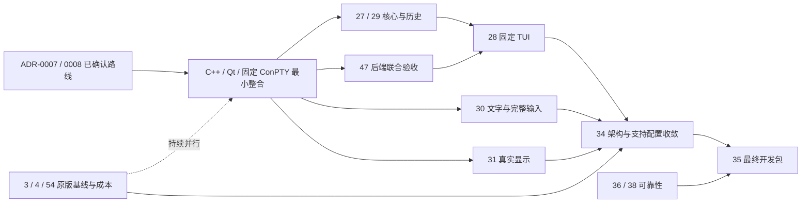

# R2 本地终端与开发版：交付路线与验收

本文件细化 [PLAN 的 R2 出口](../PLAN.md#r2可靠本地终端持久化与可发布开发版)，维护交付顺序、工作边界与验收，不改变原范围。当前能力和构建配置只在 [FEATURES](../FEATURES.md)维护；[TRACKING](../TRACKING.md)导航到任务；实时状态与阻塞以[总项 #7](https://github.com/JavaZeroo/termforge/issues/7)及原生关系为准。关闭数量不用于计算完成率。

用户结果：在明确支持的 Windows 环境中，用固定本地 shell、分页器和编辑器完成连续工作；复杂文字、输入和会话互相一致；重启后恢复已声明的配置；最终下载包能从公开源码复建。

方向约束见 [ADR-0006](../adr/0006-confirmed-project-direction.md)：优先对齐终端基础能力与性能，首个完整版本环境为 Windows 11 x64，R2 是其中的阶段性交付。原版行为优先；正式核心已确认继续自主开发 C++，当前 GUI 路线采用 [Qt Widgets](../adr/0008-cpp-core-qt-widgets.md)，Windows PTY 采用[随包固定微软 ConPTY](../adr/0007-bundled-microsoft-conpty.md)。独立切片推进新组合整合，#34/#47 汇总接口与后端验收；性能容差在可靠基线后另行明确。历史已验合同继续作为回归依据，原版未知和重要差异由相应任务取证及提交确认。

## 当前站位

R2 的平台调查、有限会话与恢复及 Alacritty 参考实验已有各自限定交付。当前正式路线为**自主 C++ 核心、Qt Widgets 与随包固定微软 ConPTY**；[最小可构建单会话入口 #115](https://github.com/JavaZeroo/termforge/issues/115)与[固定依赖专用 CI #117](https://github.com/JavaZeroo/termforge/issues/117)已合入 main，完成固定 80×24、本地 cmd 输入输出、错误和关闭回收的限定验证。Qt 固定 cmd 多标签已有[会话隔离与退出前回收的限定验证](../../experiments/shell/results/2026-10-28-qt-tabs/README.md)，接续补 C++ 核心能力、工作区恢复和完整用户工作流。[原版模式 #118](https://github.com/JavaZeroo/termforge/issues/118)与[本地 cmd 正确性工具 #119](https://github.com/JavaZeroo/termforge/issues/119)已分别交付限定证据，剩余样式、C0 和性能端点继续调查。现有 C++ 核心仍是有限子集；候选的首批字素、TUI 与重排成功不转记为 C++ 能力。已有 Alpha、Win32 原型、Alacritty 和 Draft 后端保留固定身份，新组合需要自己的证据。

历史联合源码 `3e5b96d` 的三配置[真实基线](../research/joint-conpty-baseline.md)及其后续限定修复继续用于复用输入、接入经验和复验原失败；它们不证明新的 C++/Qt/固定后端组合已通过。Draft #50 的后端成果接入当前路线后仍须验证原合同，路线确认不解除失败或跳过项。

## R2 内部的四段交付

下表是同一个 R2 路标内的接续顺序，不新增产品路标。独立调查和测试准备可并行；每段的完成由出口决定。

| 阶段 | 用户可审查的交付 | 责任与完成条件 |
|---|---|---|
| 1. 建立正式路线最小整合 | 自主 C++、Qt Widgets 与固定微软 ConPTY 形成可构建、可观测的最小入口 | 独立实施切片固定 source/依赖/二进制/包身份，复用 #47 接入并验证最小输出、尺寸、退出与回收；#34 汇总接口与迁移边界。先形成基线，不搭大型应用骨架，也不宣称现有候选能力已经移植 |
| 2. 闭合核心、兼容性与输入 | 声明的 shell、固定 TUI、复杂文字与会话交互在新组合中连续工作 | #27/#29 补 C++ 模式、软硬行、历史与 resize；#28 验收真实应用/回复/输入模式，#30 补复杂文字与 IME/选择/粘贴。#39 参考成果、#51/#53/#62/#63 限定后端修复分别重验，真实不同 DPI 由 #31 并行提供 |
| 3. 收敛架构、支持配置与性能证据 | 已定路线的接口、依赖、迁移和资源策略有可审查实现与证据 | #34 复用 #23/#26/#32/#33 及新组合工作流，收敛核心/历史、GUI/平台、传输/呈现、背压/取消与维护边界；#54 提供受控成本，原版重要差异和数值容差仍由用户确认 |
| 4. 验收最终开发包 | 用户从公开源码复建或解压下载包，在声明环境中完成固定工作流 | #35 在最终产物上复验本页全部门槛、配置升级/恢复、错误/回收及预先冻结的持续运行与资源合同；#36/#38 的可靠性出口必须闭合。来源、许可、说明与产物身份一致后，才结项 #7 |

关键依赖如下；实线为硬前置，虚线为联合复验条件，省略已关闭前置和冗余边。完整原生关系在 GitHub。

## 下一批的任务边界

1. **从正式路线最小整合接续工作区和后端复验。** #115 已限定验证固定 80×24 单会话，#117 已完成固定依赖的独立 Windows CI；[#124](https://github.com/JavaZeroo/termforge/issues/124)已限定验证 cmd 标签输入/关闭隔离与事件循环退出前回收，完整工作区和恢复仍另行迁移。基础动态网格与真实 child 同步见 [#143 的限定证据](../../experiments/shell/results/2026-10-29-qt-resize/README.md)；完整 resize/历史、其他 C++ 核心模式和 Qt 交互继续闭合。#55 已交付含红的真实基线；#51 原生 viewport resize、#63 工作区原生 viewport，以及 #62 的[真实 writer 持块、取消与停止夹具](../research/sender-fence.md)和 #53 原 UI/3MB/八会话 data-only 合同均已在各自范围验证并整合到实验父分支。接续 #52 GUI Vim 与 #47 的完整官方矩阵、同次真实 CF/IME；限定切片关闭不等于联合验收通过。未完成项可以用原冻结输入独立定位，最终修复验收须在联合配置重建；期限、负载和原失败保留，一次未复现不自动构成因果修复。
2. **并行处理原版对照、平台语义与性能。** [原生语义处理路径 #56](https://github.com/JavaZeroo/termforge/issues/56)先明确 #41 原合同需要什么、哪些路径可支持；保留必要的上游或独立实现工作，不用“平台不同”豁免缺口。#3/#4 优先建立原版 Windows 本地终端基线；#54 现在冻结重复方法与完成端点并定位吞吐成本，数值预算作为提案交用户确认，不等到 #34 才补性能。
3. **按原版合同补自主 C++ 能力。** #29 核对极窄/极短、软硬行、历史/淘汰、选择/Find、连续 resize 和 child ack；#30 核对 IME 组合/提交/取消与输出/resize/切换、应用键盘/粘贴接收、实际复制及同次八会话。已验收的 #39 提供的是参考实现与固定场景；自主 C++ 是否具备同等字素能力必须独立实现和验证。
4. **补终端模式和应用矩阵。** #27 明确 DECOM/DECAWM、pending-wrap、保存恢复、异常序列与 margin×resize；#28 先固定应用版本/入口/动作及协议字节预期，再逐应用完成进入、操作、resize、退出、主屏恢复。Vim 的一个修复不替代完整 TUI 验收。
5. **独立推进真实显示与可靠性。** [#131 的隔离 Windows 11 环境](../research/r2-win11-display-environment.md)已建立，两个实际输出的 96/120 DPI 和独立窗口往返已验证；#31 接续正式 Qt 产品的焦点、IME/Find/rename、命中、隐藏会话和 child 尺寸流程。未迁移的产品能力先独立实现，不改个人显示设置。#36/#40/#44 及[旧 normal-1 事件 #57](https://github.com/JavaZeroo/termforge/issues/57)按有停止条件的诊断批次推进，原失败和未知保留，不阻塞其他独立工作。

## 并行工作与停止条件

| 工作 | 每次执行必须产出 | 遇到缺口如何处理 |
|---|---|---|
| 联合基线后的后端修复 | 对同一 source/负载/期限的反例、最小原因与完整动作结果；native、transport、核心、glyph 和回收分列 | 有因果 red→green 才写修复；暂未复现保留旧输入和未知，不改 oracle 或等待预算 |
| #3/#4 原版基线及 #54 受控性能 | 正确性、固定负载/环境/配置、无观察或观察成本边界、重复样本、分层归因与预算提案 | 当前约 16%/9% 的吞吐成本只是共享宿主诊断；没有正式 WindTerm 基线或实际端点就保持未知；具体容差由用户明确后生效 |
| #31 真实不同 DPI | 在已有隔离 96/120-DPI 环境记录正式产品跨屏输入/焦点/网格/隐藏会话和真实 child 尺寸 | 独立 Win32 环境探针不代替 Qt 产品流程；消息模拟、受控 DIB 和提交时刻不计物理输入或实际呈现 |
| 历史可靠性 #36/#40/#44 与 #38 未知事件 | 一次预先限定的假设/样本批次，包含事件阶段、原期限、源码/宿主身份和清理 | 未复现就报告该批未复现，更新下一可证伪假设；不无限重跑取绿，也不由规划整理解除 #35 的出口 |

## 必须闭合的验收门槛

| 门槛与责任项 | 验收必须证明什么 | 不能代替验收的结果 |
|---|---|---|
| 回归可靠性：#36、#38（含 #40、#44、#57、#73、#80、#81、#85） | 持续输出中断、controller 子进程到 shell 的正常退出、原 10 秒纯夹具及保存/选择、四 shell 交接、hosted 准备和复制夹具失败路径均有明确阶段、字节、退出和自有 Job 回收证据；修复对应真实失败，最终声明配置的完整回归通过 | 多次重跑绿不能回填旧失败原因；close 后的退出码不能冒充自然退出；增加超时或跳过不能解除阻塞 |
| 终端模式：#27、#41 | **VT／transport／末端层**：自主 C++ 核心主/备用屏、各自滚动区域、origin/wrap、光标/样式、历史隔离及 resize 交叉符合原版合同；**原生控制台层**：CHAR_INFO 的每屏 margin 记为[已知差异](../adr/0007-bundled-microsoft-conpty.md#已知差异)，依赖原生 Console API 的应用与末端不同步属已声明边界 | 历史候选 feed 正确不等于 C++ 已实现；末端不能猜测补回宿主已丢失的信息；固定 ConPTY 末端正确不等于原生 API 状态已修复 |
| resize 与真实 TUI：#29、#28 | 逻辑/物理行、宽字符、历史与淘汰有明确策略；窗口、核心和真实子进程尺寸一致；固定应用逐一完成进入、操作、resize、退出、主屏恢复；回复、输入模式和 bracketed paste 字节经独立预期验证 | 离线回放、单独 Vim 成功或默认核心通过，不能代表整个候选产品矩阵；未声明应用不计完成 |
| 复杂文字与输入：#30（参考 #39） | 在自主 C++ 和 Qt 声明配置核对原始标量、字素边界、宽度/光标、实际 glyph、复制与子进程接收，完成固定 IME 与同次八会话交叉 | #39 的 Alacritty/DWrite 限定结果不代表新核心或 Qt 已具备对应能力；未知 WindTerm 行为继续调查 |
| 真实显示：#31 | **R2 范围限定单显示器**（96/144 DPI 的渲染正确性）；真实跨屏迁移**移出 R2**，推迟到 R4（决策 4C，见 [ADR-0009](../adr/0009-r2-scope-decisions.md)）。单屏部分仍需按[字体/显示合同](R2-font-display.md)记录实际 DPI、焦点、IME/Find/rename、命中、隐藏会话及子进程尺寸；环境身份和重复结果可核对 | 相同 96 DPI 的两台显示器、受控消息、DIB 或实际提交时刻不能代替不同 DPI 或实际上屏证据；不得修改个人显示设置制造验收。跨屏证据缺失不构成 R2 阻塞，但也不能被表述为已验证 |
| 产品架构：#34 | 按 ADR-0007/0008 已定路线，以实际工作流、原版对标及成本证据收敛核心/历史/GUI/传输接口、资源与维护边界；记录实际支持配置 | 路线已确认不等于功能、平台、长期资源或性能验收通过；重大替换、重要差异和数值门槛仍需用户确认 |
| 开发版交付：#35 | 按**决策 5C**：R2 交付范围为"本地终端基础 + 已知差异清单"（见 [ADR-0009](../adr/0009-r2-scope-decisions.md)），产物需通过干净构建、依赖/字体许可与清单审计、解压运行、shell/TUI/文字/配置升级工作流，并随附逐条列出的未实现/未验证项 | Alpha 1、源码构建成功、短驻留或某一 CI 通过，不代表 R2 日常开发包、长期稳定或 WindTerm 性能等价；已知差异清单不完整则该交付不成立 |

#32 本地 shell/分屏标签、#33 会话与配置恢复已有各自限定合同；最终集成仍须复验这些合同。R2 不扩大为 SSH/SFTP、任意嵌套分屏、完整 WindTerm UI 或跨平台客户端；这些任务继续按 PLAN 的对应路标推进。

## 证据与完成规则

- 每个结果保留源码/二进制、系统/后端、输入/负载身份，以及实际通过、失败和跳过；不同源码或补充运行不拼成一次“全绿”。
- 控制台、模型、DWrite 布局、DIB、窗口提交和实际呈现各自留证；未观测端点保持 unknown/null。
- 只公开经审核的合成输入和脱敏摘要；运输原件、用户路径、桌面身份等按现有来源规则处理。真实原生会话的宿主和子进程须在自有 Job 中启动、超时和回收；离线模型回放另列实际期限与监督范围，不能由进程 timeout 推断 Job 回收。
- 单项完成更新其 issue、FEATURES 与 EVIDENCE；原失败仍保留。若需改变范围、主要路线、验收门槛或接受重要差异，先提交证据和具体方案供用户确认，不能用新合同证明旧合同已完成。
- #7 由 #35 对所有出口逐项核对后结项；正式 WindTerm 性能基线继续独立推进，不由本表推断已经等价。
