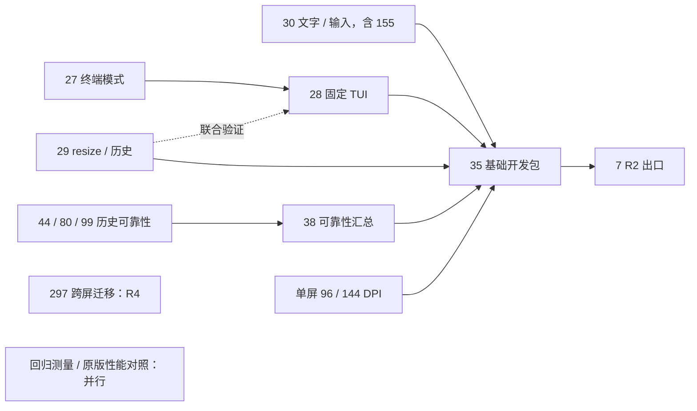

# R2 本地终端与开发版：交付路线与验收

本文件细化 [PLAN 的 R2 出口](../PLAN.md#r2可靠本地终端持久化与可发布开发版)，维护范围、依赖和验收合同。当前能力与构建配置见 [FEATURES](../FEATURES.md)，执行入口见 [TRACKING](../TRACKING.md)，实时状态、计数与阻塞以[总项 #7](https://github.com/JavaZeroo/termforge/issues/7)和责任 issue 为准；本页不累计批次日志，也不按关闭数量计算完成率。

## 用户结果与已确认边界

按 [ADR-0006](../adr/0006-confirmed-project-direction.md)、[ADR-0007](../adr/0007-bundled-microsoft-conpty.md)、[ADR-0008](../adr/0008-cpp-core-qt-widgets.md)，正式路线为自主 C++ 核心、Qt Widgets 与随包固定微软 ConPTY，首个完整版本目标为 Windows 11 x64。R2 是其中的阶段交付，按 [ADR-0009](../adr/0009-r2-scope-decisions.md)提供**本地终端基础 + 已知差异清单**，不宣称日常可用、完整 WindTerm 复刻或性能等价。

- 单显示器 96/144 DPI 留在 R2，由 #35 在最终产品上收口；真实跨屏、异 DPI 往返和跨屏交互移至 R4 的 [#297](https://github.com/JavaZeroo/termforge/issues/297)。#31 的范围收口不表示正式 Qt 完整显示流程已验收。
- #34 按架构收敛说明、#47 按路线已整合收口；产品默认入口切换后的重建复验归 #35。原生 `CHAR_INFO` 的 margin 差异继续按 ADR-0007 记录；经确认的原版缺陷修正只适用于 ADR-0009 决策 6 的固定场景。
- #27/#28 的终端模式与 TUI，以及用户明确保留的 #29 resize/逻辑行、#30 Unicode/IME 仍需完成；#155 是 #30 的 Qt IME 子项。差异清单不能自动豁免这些保留任务。
- R2 性能采用回归型治理；可靠基线、测量方法和数值容差须明确，未经用户确认的数值不作门禁。WindTerm 正式性能对照持续并行，不再作为基础开发包的等价性能前置。
- 已按用户决定收口的旧诊断、实验后端或范围项不重新列为全部必须修复的清单；关闭不改写原失败原因，也不等于产品能力验收。新的重要偏差、范围调整和豁免仍须用户确认。

范围处置与承接依据见 [#38 的用户决定记录](https://github.com/JavaZeroo/termforge/issues/38#issuecomment-6554935496)、[#34 收敛说明](https://github.com/JavaZeroo/termforge/issues/34#issuecomment-6554932972)、[#47 交付承接](https://github.com/JavaZeroo/termforge/issues/47#issuecomment-6554930225)。

## 交付顺序与责任

正式路线已有最小入口、固定依赖 CI、有限 cmd 标签和尺寸/输入切片；它们的能力与证据只在 FEATURES 汇总。后续围绕以下用户结果闭合，独立调查与测试准备可以并行。

| 工作包 | 责任项 | 完成条件 |
|---|---|---|
| 终端状态与模式 | [#27](https://github.com/JavaZeroo/termforge/issues/27) | 主/备用屏、滚动区域、origin/wrap、光标/样式和历史隔离在保留合同内一致；核对分块、重复切换及 resize 交叉，不由某一模式切片推断完整兼容 |
| 查询、应用模式与 TUI | [#28](https://github.com/JavaZeroo/termforge/issues/28) | 冻结应用版本、启动入口、动作和独立协议预期；实际完成进入、操作、resize、退出与主屏恢复，并声明支持矩阵 |
| resize、逻辑行与历史 | [#29](https://github.com/JavaZeroo/termforge/issues/29) | 极窄/极短、软硬行、宽字符、历史/淘汰、选择/Find 和连续 resize 的保留合同；窗口、核心、transport 与真实 child 尺寸分别核对 |
| Unicode、IME 与文字交互 | [#30](https://github.com/JavaZeroo/termforge/issues/30)，含 [#155](https://github.com/JavaZeroo/termforge/issues/155) | 自主 C++/Qt 的文字、字素、绘制、复制、粘贴、键盘和固定 IME 交叉；组合/提交/取消、输出/resize/切换及约定多会话在同一配置验证 |
| controller 正常退出 | [#44](https://github.com/JavaZeroo/termforge/issues/44) | 核对 child→cmd 自然退出与 close 前观测；清理后的退出码不得冒充自然退出 |
| 四 shell 退出事件 | [#80](https://github.com/JavaZeroo/termforge/issues/80) | 区分真实 shell 就绪、输入交接和生命周期；已有握手修正不回填原 hosted 事件因果 |
| 剪贴板占用后超时 | [#99](https://github.com/JavaZeroo/termforge/issues/99) | 定位占用反馈后的阶段、helper/owner 回收与重试，保持原输入、负载和期限；回收成功不代替工作流完成 |
| 基础开发包与最终复验 | [#35](https://github.com/JavaZeroo/termforge/issues/35) | 固定产品默认入口与产物身份，复验声明能力、单屏显示、配置范围和可靠性，完成来源许可、干净环境使用及逐项差异清单 |

#38 聚合可靠性结论，#7 聚合 R2 出口；二者不重复计为实现工作包。#155 归入 #30，不另算一套文字交付。完整原生父子和阻塞关系以 GitHub 为准。

## 最终产物的验收门槛

| 门槛 | 必须证明什么 | 不能代替验收的结果 |
|---|---|---|
| 产品配置与后端 | 固定 C++/Qt/ConPTY 来源、依赖、二进制和包身份；产品默认切换后重建，验证输出、尺寸、启动失败、关闭和回收 | #34/#47 关闭、旧 Win32 或 Alacritty 通过，都不等于最终产品通过 |
| 核心与应用 | 按 #27/#28/#29 保留合同验证实际支持的模式、历史、尺寸和 TUI；已确认的原生 API 差异单列 | feed 或单独 Vim 成功不代表完整应用矩阵；不能猜测补回 transport 已丢失的信息 |
| 复杂文字与输入 | 按 #30/#155 核对原始标量、字素边界、宽度/光标、实际 glyph、复制和接收字节，完成规定的 IME 与会话交叉 | 历史 #39 的参考结果、单次提交成功或候选框几何，不自动验收完整输入；未知原版行为保持未知 |
| 单屏显示 | 按[字体/显示合同](R2-font-display.md)验证正式 Qt 产品在单屏 96/144 DPI 的渲染与声明交互；记录实际 DPI、焦点、命中、隐藏会话和 child 尺寸 | presentation 探针、受控消息或同 DPI 双屏不代替正式产品流程；跨屏缺失不阻塞 R2，也不能写成已验证 |
| 会话与配置声明 | 声明最终包实际支持的 shell、标签/分屏和保存范围；已声明的启动、退出、恢复、升级及损坏回退在最终包验证 | #32/#33 的旧 Win32 限定成功不转记为 Qt；未迁移项必须写入差异清单，不称完整恢复 |
| 可靠性 | #38 汇总 #44/#80/#99 的明确结论，并在最终声明配置保留错误、退出和自有 Job 回收检查；按预先冻结的运行/资源合同复验 | 无限重跑取绿、增加超时或清理后码不能解释原失败；已接受旧诊断不因本页整理重开，未决项不自行豁免 |
| 构建与分发 | 公开源码可复建，干净环境可解压运行；字体/依赖来源、许可、文件清单和操作说明与实际包一致 | Alpha 1、单项 CI 或短驻留不代表新产品包、长期稳定或性能等价 |
| 已知差异清单 | 每条区分未实现、未验证、已确认差异和已知缺陷，关联责任项与证据；用户保留任务完成后才核对 #7 出口 | 清单不能把任意缺口变成自动接受，也不能用缩小后的范围证明原范围已经完成 |

## 并行调查与停止条件

原版未知行为、性能对照和 R4 跨屏准备可独立推进，不重新阻塞已按用户决定收口的路线项。每次实验先固定源码、负载、环境、端点、期限、样本数和停止条件；出现失败就保留原件，未复现只报告本批未复现，不补造因果或无限重试。

性能记录须有工作负载、正确性、原始样本和观察成本边界。已有诊断护栏保持原用途；#54 按回归型方向收口不表示成本测量通过、批准数值容差或追平 WindTerm。可靠基线和用户确认尚缺时，明确保持未评价。

## 证据与完成规则

- 每个结果保留源码/二进制、系统/后端、输入/负载身份，以及实际通过、失败和跳过；不同源码或补充运行不拼成一次“全绿”。
- 控制台、模型、布局/绘制、窗口提交和实际呈现各自留证；未观测端点保持 unknown/null。
- 只公开经审核的合成输入和脱敏摘要。真实原生会话在自有 Job 中启动、监督和回收；进程 timeout 不等于 Job 回收。不得改变个人显示设置来制造验收。
- 单项完成更新责任 issue、FEATURES 与 EVIDENCE；原失败、接受的范围调整和重开条件保留。重要新差异或验收变更由用户确认。
- #35 逐项核对最终包和本页保留合同后，才结项 #7。R2 不包含 SSH/SFTP、任意嵌套分屏、完整 WindTerm UI、跨平台客户端或 WindTerm 性能等价；这些继续按 PLAN 的后续路标验收。
