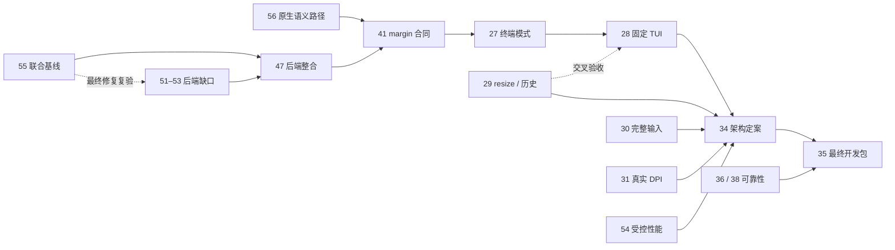

# R2 本地终端与开发版：交付路线与验收

本文件细化 [PLAN 的 R2 出口](../PLAN.md#r2可靠本地终端持久化与可发布开发版)，维护交付顺序、工作边界与验收，不改变原范围。当前能力和构建配置只在 [FEATURES](../FEATURES.md)维护；[TRACKING](../TRACKING.md)导航到任务；实时状态与阻塞以[总项 #7](https://github.com/JavaZeroo/termforge/issues/7)及原生关系为准。关闭数量不用于计算完成率。

用户结果：在明确支持的 Windows 环境中，用固定本地 shell、分页器和编辑器完成连续工作；复杂文字、输入和会话互相一致；重启后恢复已声明的配置；最终下载包能从公开源码复建。

方向约束见 [ADR-0006](../adr/0006-confirmed-project-direction.md)：优先对齐终端基础能力与性能，首个完整版本环境为 Windows 11 x64，R2 是其中的阶段性交付。原版行为优先；Alacritty 保留为候选，核心/GUI/后端正式方案及性能容差需用户确认。历史已验合同继续作为回归依据，原版未知和重要差异由相应任务取证及提交确认。

## 当前站位

R2 的前期平台调查/候选比较、有限会话与恢复、首批流式字素已有各自限定交付；这些研究不代表用户确认正式核心路线。剩余工作集中在**联合配置、原版对照、兼容与输入、环境、性能、用户选型确认及最终产物**。已有证据继续复用；已发布 Alpha、主线显式候选、Draft 官方后端是不同配置，证据不得互借。

联合源码 `3e5b96d` 的三配置[真实基线](../research/joint-conpty-baseline.md)已在实验分支冻结，包含原场景及完整回归的明确失败；近期转向这些失败的因果修复与复验。基线交付不选择默认后端或宣布兼容性通过，Draft #50 仍需通过原有回归。

## R2 内部的四段交付

下表是同一个 R2 路标内的接续顺序，不新增产品路标。独立调查和测试准备可并行；每段的完成由出口决定。

| 阶段 | 用户可审查的交付 | 责任与完成条件 |
|---|---|---|
| 1. 冻结联合基线 | 主线候选和显式官方后端来自同一份可重建源码；系统对照与联合配置各有实际结果 | [联合基线 #55](https://github.com/JavaZeroo/termforge/issues/55)：固定 source/依赖/二进制/包/flags，验证 API 生命期、原 175B margin、Unicode/glyph、真实尺寸 ack、退出与回收；重放 #51–#53 原场景，分列 red、green 和未复现。默认路线与 #34 产品决定保持不变 |
| 2. 闭合兼容性与输入 | 明确支持的 shell、分页器、编辑器、复杂文字与会话交互在联合配置中连续工作 | #47/#51–#53 处理后端；#41 处理原生 API/末端语义；#27/#29 核对模式与 resize，#28 验收固定 TUI/回复/输入字节，#30 验收完整 IME/选择/粘贴。实际不同 DPI 由 #31 并行提供 |
| 3. 提交并确认产品架构与支持配置 | 提供可比较的核心/后端/GUI 方案、证据和取舍，经用户确认后定案 | #34 使用 #23/#26、#28–#33 的真实结果与 #54 的受控成本，重审 ADR-0003/0004；明确 Windows 11 x64 优先、未来平台障碍、接口、并发/取消和维护成本；范围及重要差异依 ADR-0006 确认 |
| 4. 验收最终开发包 | 用户从公开源码复建或解压下载包，在声明环境中完成固定工作流 | #35 在最终产物上复验本页全部门槛、配置升级/恢复、错误/回收及预先冻结的持续运行与资源合同；#36/#38 的可靠性出口必须闭合。来源、许可、说明与产物身份一致后，才结项 #7 |

关键依赖如下；实线为硬前置，虚线为联合复验条件，省略已关闭前置和冗余边。完整原生关系在 GitHub。

## 下一批的任务边界

1. **在已冻结基线上逐项闭合后端回归。** #55 已交付含红的真实基线；接续 #52、#63 的独立失败。#62 的[真实 writer 持块、取消与停止夹具](../research/sender-fence.md)不降低原 4MiB/16KiB/期限，#53 已接入默认关闭的 fence，[单窗口 UI/3MB/768B 与控制故障切片](../research/ui-paste-fence.md)及[同源码两轮原八会话data-only](../research/resize-replay-cost.md)已通过；[#51 原生 viewport 修复](../research/native-viewport-resize.md)的原 resize 与 Unicode、[#88 回显完成判据](../research/workspace-restore-transport-oracle.md)的原保存/恢复/钳制限定回归通过；[#87 完整记录检查点](../research/workflow-record-checkpoint.md)已具有受控因果红绿及同源码两轮原八会话 data-only。完整官方回归中的 Vim、历史工作区失败及聚合期限证据分别保留，#87 的历史运输缺口不追溯补造，真实 CF/IME 组合独立验收。各回归可用原冻结输入独立定位，最终修复验收须在联合配置重建；一次未复现不自动构成因果修复。
2. **并行处理原版对照、平台语义与性能。** [原生语义处理路径 #56](https://github.com/JavaZeroo/termforge/issues/56)先明确 #41 原合同需要什么、哪些路径可支持；保留必要的上游或独立实现工作，不用“平台不同”豁免缺口。#3/#4 优先建立原版 Windows 本地终端基线；#54 现在冻结重复方法与完成端点并定位吞吐成本，数值预算作为提案交用户确认，不等到 #34 才补性能。
3. **在主线推进独立行为合同。** #29 核对极窄/极短、软硬行、历史/淘汰、选择/Find、连续 resize 和 child ack；#30 核对 IME 组合/提交/取消与输出/resize/切换、应用键盘/粘贴接收、实际复制及同次八会话。已验收的 #39 只提供首批字素基础，最终配置的交叉验收仍需执行。
4. **补终端模式和应用矩阵。** #27 明确 DECOM/DECAWM、pending-wrap、保存恢复、异常序列与 margin×resize；#28 先固定应用版本/入口/动作及协议字节预期，再逐应用完成进入、操作、resize、退出、主屏恢复。Vim 的一个修复不替代完整 TUI 验收。
5. **独立推进真实显示与可靠性。** #31 当前缺实际不同 DPI 环境；优先自动探测或准备隔离测试宿主，不改个人显示设置、不反复测试同两台 96-DPI 屏幕。#36/#40/#44 及[旧 normal-1 事件 #57](https://github.com/JavaZeroo/termforge/issues/57)按有停止条件的诊断批次推进，原失败和未知保留，不阻塞其他独立工作。

## 并行工作与停止条件

| 工作 | 每次执行必须产出 | 遇到缺口如何处理 |
|---|---|---|
| 联合基线后的后端修复 | 对同一 source/负载/期限的反例、最小原因与完整动作结果；native、transport、核心、glyph 和回收分列 | 有因果 red→green 才写修复；暂未复现保留旧输入和未知，不改 oracle 或等待预算 |
| #3/#4 原版基线及 #54 受控性能 | 正确性、固定负载/环境/配置、无观察或观察成本边界、重复样本、分层归因与预算提案 | 当前约 16%/9% 的吞吐成本只是共享宿主诊断；没有正式 WindTerm 基线或实际端点就保持未知；具体容差由用户明确后生效 |
| #31 真实不同 DPI | 可识别的实际环境、跨屏输入/焦点/网格/隐藏会话和真实 child 尺寸记录 | 无环境则保留环境阻塞，继续隔离宿主自动化准备；消息模拟或受控 DIB 不计真实跨屏 |
| 历史可靠性 #36/#40/#44 与 #38 未知事件 | 一次预先限定的假设/样本批次，包含事件阶段、原期限、源码/宿主身份和清理 | 未复现就报告该批未复现，更新下一可证伪假设；不无限重跑取绿，也不由规划整理解除 #35 的出口 |

## 必须闭合的验收门槛

| 门槛与责任项 | 验收必须证明什么 | 不能代替验收的结果 |
|---|---|---|
| 回归可靠性：#36、#38（含 #40、#44、#57、#72、#73） | 持续输出中断、controller 子进程到 shell 的正常退出、原 10 秒纯夹具及新保存/选择失败路径均有明确阶段、字节、退出和自有 Job 回收证据；修复对应真实失败，最终声明配置的完整回归通过 | 多次重跑绿不能回填旧失败原因；close 后的退出码不能冒充自然退出；增加超时或跳过不能解除阻塞 |
| 终端模式：#27、#41 | 候选核心主/备用屏、各自滚动区域、origin/wrap、光标/样式、历史隔离及 resize 交叉符合固定合同；真实 ConPTY 路径保留实现这些语义所需的信息 | 独立核心 feed 正确不能补足宿主已经丢失的信息；不能猜测补发原运输中不存在的 VT，或用“已知平台差异”自行关闭功能缺口 |
| resize 与真实 TUI：#29、#28 | 逻辑/物理行、宽字符、历史与淘汰有明确策略；窗口、核心和真实子进程尺寸一致；固定应用逐一完成进入、操作、resize、退出、主屏恢复；回复、输入模式和 bracketed paste 字节经独立预期验证 | 离线回放、单独 Vim 成功或默认核心通过，不能代表整个候选产品矩阵；未声明应用不计完成 |
| 复杂文字与输入：#30（复用已验 #39） | 保留首批字素合同，在最终配置核对原始标量、宽度/光标、实际 glyph、复制与子进程接收；完成固定 IME 与同次八会话交叉回归 | #39 的字素与单列 resize 成功不代表完整 IME、应用模式或 R1 系统输入组合在另一配置已通过；未知 WindTerm 行为仍保留 |
| 真实显示：#31 | 按[字体/显示合同](R2-font-display.md)记录实际不同 DPI、真实跨屏、焦点、IME/Find/rename、命中、隐藏会话及子进程尺寸；环境身份和重复结果可核对 | 相同 96 DPI 的两台显示器、受控消息、DIB 或实际提交时刻不能代替不同 DPI 或实际上屏证据；不得修改个人显示设置制造验收 |
| 产品架构：#34 | 基于实际工作流、原版对标及 #23/#26/#32/#33/#54 的证据，重审 ADR-0003/0004；提出核心、GUI/平台、历史/快照、传输/呈现、背压/取消和维护方案，记录用户确认依据 | 原型已采用某技术、历史 issue 关闭或候选已有接口，不构成最终产品选择；未测性能和未确认容差保持未完成 |
| 开发版交付：#35 | 最终下载产物通过干净构建、依赖/字体许可和清单审计、解压运行、shell/TUI/文字/配置升级/真实显示工作流；按预先冻结的负载和资源合同完成重复会话与持续运行，逐项核对本表 | Alpha 1、源码构建成功、短驻留或某一 CI 通过，不代表 R2 日常开发包、长期稳定或 WindTerm 性能等价 |

#32 本地 shell/分屏标签、#33 会话与配置恢复已有各自限定合同；最终集成仍须复验这些合同。R2 不扩大为 SSH/SFTP、任意嵌套分屏、完整 WindTerm UI 或跨平台客户端；这些任务继续按 PLAN 的对应路标推进。

## 证据与完成规则

- 每个结果保留源码/二进制、系统/后端、输入/负载身份，以及实际通过、失败和跳过；不同源码或补充运行不拼成一次“全绿”。
- 控制台、模型、DWrite 布局、DIB、窗口提交和实际呈现各自留证；未观测端点保持 unknown/null。
- 只公开经审核的合成输入和脱敏摘要；运输原件、用户路径、桌面身份等按现有来源规则处理。真实原生会话的宿主和子进程须在自有 Job 中启动、超时和回收；离线模型回放另列实际期限与监督范围，不能由进程 timeout 推断 Job 回收。
- 单项完成更新其 issue、FEATURES 与 EVIDENCE；原失败仍保留。若需改变范围、主要路线、验收门槛或接受重要差异，先提交证据和具体方案供用户确认，不能用新合同证明旧合同已完成。
- #7 由 #35 对所有出口逐项核对后结项；正式 WindTerm 性能基线继续独立推进，不由本表推断已经等价。
