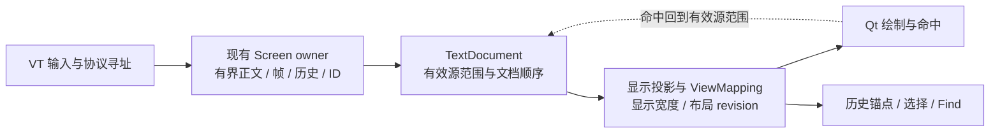

# R2 resize 正文保留与显示重排提案

**状态：2026-11-02 本会话已由用户确认按方案推进；实现与联合验收尚未完成。** 确认问答及边界见 [ADR-0010](../adr/0010-bounded-resize-retention.md)。本文承接 [#27](https://github.com/JavaZeroo/termforge/issues/27) 与 [#29](https://github.com/JavaZeroo/termforge/issues/29) 的联合切片：在现有 Screen 所有权与行身份体系内增加有界正文保留，以独立显示投影表达缩窄/增宽，并显式处理协议寻址与文字位置迁移。继续使用自主 C++、Qt Widgets 和随包固定微软 ConPTY，不增加产品后端或大依赖。

这会实质改变 Screen 的内容表示及当前物理裁剪式 resize，超出现有纯 ViewMapping 叠加，属于本次已确认的重大内容/resize 实现替换。本文保留具体方案与证据，不改变 [R2 范围及验收合同](../milestones/R2-local-terminal.md)。原版未知行为仍须调查；用户确认方向、提交、合并或局部测试通过均不等于完整实现验收。

## 依据及问题边界

| 证据 | 已观察事实 | 尚不能推出的结论 |
|---|---|---|
| [WindTerm 2.7.0 原版三阶段样本](../../research/ui/results/2026-11-02-resize-state-reference/README.md) | 受控 Telnet，公开窗口 `1360×749 → 1000×749 → 1360×749`，NAWS `91×20 → 61×20 → 91×20`；合成 `v/w/x` 的文档位置不变，可见矩形重排后恢复；三次 DSR 都为 `11;2` | 只有一个正文及一次收缩/恢复；没有后续可打印字符或 CUP，不能确定 resize 后写入、擦除、插删和协议光标怎样对应正文；不证明备用屏、复杂 Unicode、历史或本地 Shell 路径 |
| [Qt / 固定 ConPTY 模式及 resize 诊断](../../experiments/shell/results/2026-11-02-qt-terminal-modes/README.md) | 独立 `80×24 → 60×12` 场景中，native grid 重排 B/CD，核心物理裁剪丢失右端正文；第六阶段字面断言失败。另一条独立 raw transport 观测未见搬移 B/CD 或清旧 D 的重绘字节 | 不是原版相同几何，也不是同次 Qt 会话捕获；不能把 native grid 直接当 WindTerm oracle，不能认定末端 parser 忽略了重绘字节 |
| 当前 [Screen](../../experiments/core/screen.hpp) 与 [Qt 会话](../../src/qt/terminal_session.hpp)，代码身份 `abf9e23` | `resize_frame` 对行执行 `line.resize(columns)`；被截掉的单元格没有后续恢复来源。UI 请求逐次改变 core 尺寸，transport worker 从 `pending_resize_` 取最新请求 | 多次尺寸请求可能被 transport 合并、core 却逐次裁剪，是静态可达风险；尚未实测证明连续 resize 的竞态或丢字原因 |

原版结果必须区分三个坐标层。例如 `x` 的文档位置始终是零基逻辑行 9、列 91；可见矩形从 `(147,180)` 变为 `(387,198)` 再恢复；DSR 却保持一基 `(11,2)`。因此不能在显示行重排时，直接把协议光标改成新的显示行列。此样本也没有证明原版内部采用哪一种存储结构。

Qt 默认前五阶段已证明的模式行为与显式 `--resize` 第六阶段失败诊断分开保存；把前五阶段纳入回归，不代表 resize 交叉通过。#27/#29 保持开放。

## 保留现有 C 路线，扩展其内容边界

[#29 既有路线记录](https://github.com/JavaZeroo/termforge/issues/29#issuecomment-6541164759)明确采用 C：在已有 Screen owner、ID、rank、epoch 上叠加映射。[#264](https://github.com/JavaZeroo/termforge/pull/264)的 ViewMapping 命中/投影不改行存储，以文档顺序比较位置，并用 epoch 拒绝旧缓冲区页面。旧 B 栈 #108–#113 已退出候选，本提案不恢复该栈，也不新建平行的内容 owner、文档或后端。既有路线记录不是本次内容替换的批准依据；本次明确确认来自 ADR-0010 记录的用户答复。

已确认方案保留这些不变量：

- **Screen 仍是正文、主/备用帧和历史的唯一 owner。** 保留已有行 ID、版本、rank 查询及 epoch/revision 约束；ID 不是顺序，缺失 ID 不吸附到相邻行，已淘汰身份不能复活。
- **逻辑连续关系来自真实软换行。** 用既有续接关系表达哪些源片段属于同一逻辑行；不能按文本相似、相邻 ID 或裁剪后的屏幕形状猜测连接。
- **ViewMapping 继续是源范围到显示位置的值映射。** 将同一源片段按当前宽度分成多个显示范围；Qt 绘制、命中和选区投影消费同一份映射，不能各自推算换行。

本次确认新增的部分是：Screen 在变窄时不立即销毁仍应保留的右侧正文，而是把它保存在同一 owner 管理的有界源片段中；显示宽度独立决定这些片段如何呈现。具体片段可以复用现有行及其身份，必要的拆分/合并由 owner 事务完成并发布明确的位置变换。实现前以原版协议寻址样本固定其更新规则。

这不是给现有 `line.resize` 再套一层映射：正文一旦被销毁，映射无法恢复。也不另存一份无限输出日志，用旧字符串覆盖当前屏幕；覆盖、擦除、历史淘汰和模式切换必须作用于同一份权威内容。

## 核心责任与数据不变量

| 责任 | 建议边界与必须保持的性质 |
|---|---|
| Screen 内容与 resize 事务 | 保存完整 Cell 数据、明确源片段范围及软/硬边界；先准备受影响的活动帧、隐藏帧和历史，再原子发布尺寸及结构变化。无效尺寸或分配失败不留下半套状态；同尺寸请求不清空正文或制造身份变化 |
| 逻辑行与空白 | 保留硬换行及空硬行；仅连接仍成立的软换行。区分显式写入空格、未写 padding、带样式空白和宽字占位，不能用裁掉尾空格的文本导出结果重建存储。擦除后内容何时可丢弃须由明确规则决定 |
| 宽字与结合字 | lead、continuation 和结合标记作为不可拆开的存储单元迁移；宽度变化不产生孤立 continuation、丢结合标记或重复字符。不顺带声称完整 grapheme/emoji 已实现；宽度 1 的显示及后续写入策略先取证 |
| 协议状态 | 协议光标、保存光标、pending-wrap、margin/origin、样式和结合字附着位置独立于显示投影。resize 后 CUP、下一字符、CR/LF、擦除和插删如何落到源内容必须有合同，不能直接用显示行索引修改源行 |
| 主/备用屏 | 保留每帧独立正文、光标/模式、样式和历史隔离。不得假定备用屏也重排，或隐藏主屏等同活动主屏；其 resize 策略由单独原版样本决定。已有 1049/region 行为继续回归 |
| 有界保留与淘汰 | 对源片段、Cell/结合内容及历史总量保留明确上限，不能把“有界物理行”静默换成可无限增长的逻辑行。投影临时行数不直接决定正文淘汰；容量触发的淘汰、ED3、RIS 均不因增宽复活。具体容量口径及有损边界先形成可审查策略 |
| 文档身份与变更发布 | 只有显示宽度变化时，源内容身份尽量不变，发布新布局 revision；真正写入或源结构变化时更新相应版本、顺序 revision 和迁移信息。旧 page、旧范围及跨 epoch 位置须能明确拒绝，禁止“看起来相同”就当有效 |

对外只保留三个清楚的接口责任：parser 更新协议状态与正文；Screen/文档提供有效源范围及其顺序；视图产生指定宽度下的显示页和双向映射。尺寸改变所需的内容保留和位置变换封装在 owner 内，不让 Qt 或 transport 直接修补行容器。

`TextPosition` 当前包含行 ID、版本、物理列和 epoch，不能未经定义就改称逻辑字符偏移。推荐先保留这一身份接口：仅显示重排时，选择和阅读锚点仍指向原源位置；确实拆分/合并源片段时，由事务提供可验证的旧到新映射。覆盖或淘汰导致位置不再存在时，明确失效而非近邻回退。

现有 `TextSelection::reconcile` 只接受内容/范围仍相符的版本刷新，不能自动承接任意 reflow。需同时验证复制正文与高亮范围：合法的显示重排不应改变所选文本；失效结果必须可见。Find 保留查询与仍有效的导航锚点，旧 match 重新校验、按预算重扫；HistoryViewport 保留仍有效的源阅读锚点，重新发布快照和映射。完整 Qt 复制/粘贴、历史浏览与 Find 迁移仍属于已有任务，不能把模型测试算作这些 UI 已交付。

## 原版及运输仍需先回答的问题

| 未决问题 | 最小补充观察与决策边界 |
|---|---|
| 显示已换行，下一次协议写入落哪里 | 在相同正文/尺寸样本中分别追加单字符、CR/LF、独立 CUP 标记以及擦除/插删；每个动作前先采 DSR 和原 marker，动作后再采正文/矩形。不能用 CUP 后的光标冒充 resize 前状态 |
| 主/备用屏与 margin/origin | 分别在活动备用屏 resize、主屏隐藏时 resize，再返回；固定软硬行、margin、origin 和 pending-wrap。不能从主屏 ASCII 样本推断两帧策略 |
| 宽度 1、宽字/结合字及高度变化 | 分开验证宽字边缘、结合附着、缩窄/恢复、极短窗口与历史进出；先确定保留、显示和协议寻址三层的结果，再确定处理策略 |
| 连续尺寸与在途输出 | 独立记录 UI 请求、core 应用、transport 提交/完成和 child 实际尺寸，使用受控阶段握手与输出验证合并请求。静态风险先变成可复现用例，不把它写成已确认竞态 |
| 原版 Telnet 与固定 ConPTY 的差异 | 原版协议路径和 native grid 各自保存字面结果；正式本地 Shell 按其真实转换后字节另验。若需要 Windows 路径归一化，先明确字节、坐标与时序依据；重要原版偏差另由用户确认，不能猜测补注入或改变产品后端 |

Qt 现有 B/CD 诊断在 resize 后还发送了 CUP 与 `RESIZED`。因此“保留旧字＋重新显示”尚不足以保证该例通过：后续协议写入必须更新正确的源位置。不能为迎合 native 当前结果，把直接 Telnet 观测中的 DSR 自动改成显示光标。

运输侧应区分请求尺寸与实际提交/完成尺寸，避免暂时的小尺寸在 core 中不可逆丢字；具体调度修改须由交错用例驱动。ConPTY API 返回或收到某个 VT 序列，不自动构成全部输出的尺寸代际边界，也不能等待一个并不存在的完整重绘来推进 UI。

## 可独立验收的小切片

以下是已确认方案的执行切片和验证清单，不替换现有验收合同。可按依赖推进调查、实现及验证；依赖未知原版行为的部分先取证，确认方向不解除这些实际阻塞。

| 切片 | 可交付内容 | 通过条件 |
|---|---|---|
| 1. 固定 resize 后寻址合同 | 补齐上表影响数据结构的原版样本，分别列协议坐标、源内容及显示位置；冻结输入、源码/产物身份和实际几何 | 每条已观察目标有字面预期；未观察项仍标未知。与原版不同的建议有单独裁决，不从第三方默认行为填空 |
| 2. 同 owner 的有界保留与显示页 | 先实现已明确的主屏正文收缩/恢复，使用真正的软/硬边界和源范围投影；不引入第二套存储栈 | 普通文字、显式空白、样式、宽字/结合字、硬空行在允许的容量内不丢失/重复；重复 resize 稳定；容量/淘汰/失败事务可验证；整块、逐字节、分段输入结果一致 |
| 3. 协议写入和两帧交叉 | 按已冻结原版目标接入 resize 后写入/编辑、保存恢复、region/origin/wrap 与主/备用帧 | 正文、光标回复、样式和历史隔离一起核对；下一次写入位置正确；未完成的组合不纳入通过声明 |
| 4. 现有文字模型迁移 | 更新 TextDocument 定位合同、ViewMapping 页面版本、HistoryViewport、TextSelection 和 TextSearch | 旧页拒绝；反向/部分列/跨软行选区与复制一致；阅读位置稳定；搜索不返回陈旧结果；真实覆盖/淘汰不复活旧位置。Qt 已有拖选通过同一映射复验 |
| 5. 正式 Qt / 固定 ConPTY 闭环 | 用公开 Qt resize 和键动作驱动 owned child，保留原第六阶段失败源及三端记录，另加增宽恢复与尺寸合并/输出交错 | 依据已明确的目标，独立核对源 VT、native grid、core、显示页和 child 尺寸；内容不是只匹配 `RESIZED` 前缀；自然退出及 Job 回收分别检查，不延时取绿 |
| 6. 联合回归及最终交付承接 | 同一产品源码运行 #27/#29 交叉、相关文字模型和 Qt 回归，再交 #35 最终包复验 | 各构建身份、失败/跳过与原版未知逐项列明；旧红结果保留；不因五阶段模式回归成功或单一 B/CD 通过就关闭整项 |

性能先记录固定负载的内存增长、resize 工作量、输出与输入响应，并检查正确性和资源边界。不能用全量复制无限历史或反复扫描全部历史取得表面正确；也不在本文预设毫秒、内存或百分比容差。新的数值验收须按可靠基线与用户确认另定。

## 风险、备选及本次确认边界

最大风险是保住了可见正文，却错误改变后续寻址、选择或搜索：保留 owner/ID/rank/epoch 本身并不能证明这些语义正确。其次是把不可见尾部无限保存，或让每次 resize 在 UI 线程扫描全部历史。方案要求内容与投影分离、迁移可验证、有界内存与独立时序观测来控制这些风险；未知行为未解决前不完成对应实现切片。

仅为 B/CD 增加局部搬移或保留一个裁剪缓存不足以闭环：它不能解释原版 DSR 不变、后续 CUP、软硬行、样式/空白、历史淘汰和选择范围，也无法保证多次缩放恢复正确。继续只裁剪并写入已知差异可以如实描述现状，但不会完成用户保留的 #29 任务。本次选择上面的同 owner 内容扩展，不增加另一条候选实现路线。

2026-11-02 用户在本会话回答 **“按方案推进（推荐）”**，确认：**允许在既有 C 叠加路线的 owner/身份体系内，实质替换 Screen 的物理裁剪式内容/resize 实现，按上述小片推进有界正文保留、独立显示投影及位置迁移，并联动历史、选择与查找。** 完整原问、原答和问题标识见 [ADR-0010](../adr/0010-bounded-resize-retention.md)。这项确认不等于批准任何尚未知的光标/备用屏行为，不自动接受原版差异、不改变 R2 范围，也不提前验收性能或产品完整性。

确认来源要求见 [AGENTS.md](../../AGENTS.md)：

> Substantial replacements, new major dependencies or important behavior deviations need a concrete evidence-backed proposal and user confirmation.

本方案改变既有 Screen 内容及 resize 的核心职责，因此适用上述重大替换要求；本会话的明确答复已满足此次方案的确认要求。后续在确认范围内自主推进，不重复申请同一批准；新的重要行为差异或范围变更仍另行确认。

旧六阶段 B/CD 在正式 Qt/固定 ConPTY 中的寻址取舍尚未决定，具体冲突、互斥路线与最小取证计划见[决策材料](r29-bcd-local-addressing-decision.md)；该材料不改变本方案已确认的内容保留方向。
