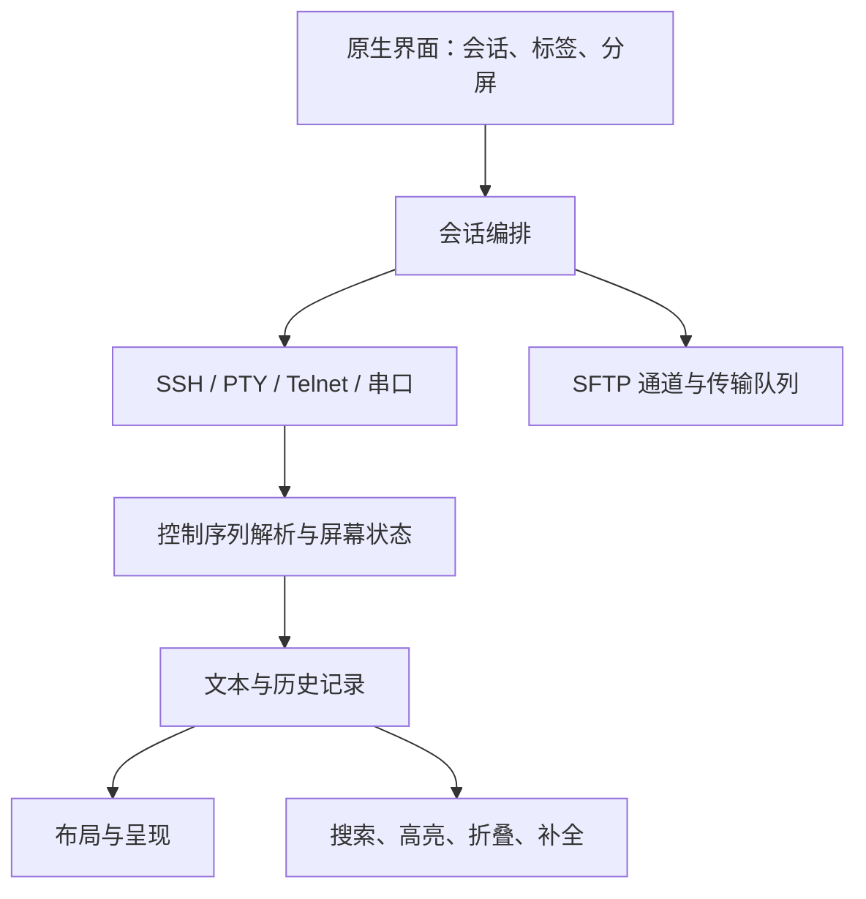

# WindTerm 公开边界与初步架构调查

> 历史调查：维护状态和“下一步”均指调查时点。当前能力见 [FEATURES](../FEATURES.md)，现行路线见 [PLAN](../PLAN.md)；本文不再作为执行待办。

调查日期：2026-10-19。范围：官方公开仓库、Windows 2.7.0 发行文件的静态检查。未进行运行时性能测量，未获得完整反编译调用图。本文记录事实与设计线索，不包含专有实现内容。

## 公开维护状态

- 官方 master 与 2.7.0 tag 均指向 `a8336c1d1e3dd1a981500dae8ef9eb42066de95f`，最后提交于 2025-02-10，更新 README。
- `src` 最后变更为 `be6e770876f5aad290bf5b7109ca1aa306bf02cf`，2021-03-11。
- 最新正式 release 2.7.0 发布于 2025-03-11 19:12:09 UTC。仓库未归档，长期无公开更新不证明作者已永久放弃。

来源：[仓库](https://github.com/kingToolbox/WindTerm)、[release](https://github.com/kingToolbox/WindTerm/releases/tag/2.7.0)、[源码最后提交](https://github.com/kingToolbox/WindTerm/commit/be6e770876f5aad290bf5b7109ca1aa306bf02cf)。这些是调查时快照，后续可能变化。

## 实际公开源码

检出提交共 536 个跟踪文件，`src` 529 个；libssh 383 个、Onigmo 118 个，共 501 个第三方派生库文件。剩余内容中有 25 个 h/cpp 文件，共 2930 物理行（含注释与空行）。完整私有源码规模未知，不能由此计算开源百分比。

| 模块 | 内容 | 边界 |
|---|---|---|
| libssh | 基于 0.9.5，包含 Pageant/外部 socket 等修改 | 不包含产品会话管理和 SFTP 调度 UI |
| Onigmo | 基于 5.13.5，迭代器支持非连续内存匹配 | 不等于公开了整个文本引擎 |
| Pty | ConPTY、WinPTY、Unix PTY 的 Qt 包装 | 本地进程传输，不是终端模拟器 |
| Protocols | Telnet 常量、名称映射、默认选项 | 未包含完整字节流解析/协商状态机 |
| Utility | 缓冲、线程、加密、作用域等工具 | 少量独立组件 |
| Widgets | PopupWidget、64 位 ScrollBar、Splitter | 不是完整应用界面 |

未在该源码快照找到完整应用入口/构建、VT 状态机、DIGEdit 整合、历史压缩、会话管理、传输队列、完整窗口和发行工程。不能从这份仓库直接构建 WindTerm.exe。

来源：[固定提交 src](https://github.com/kingToolbox/WindTerm/tree/a8336c1d1e3dd1a981500dae8ef9eb42066de95f/src)。

## 本地发行物静态事实

目标为 Windows x86-64 WindTerm.exe，13,534,720 字节，SHA-256 `cd6019817313030de1849633de7fe58af3361a1ccd8045fb086570fb7f4ed833`。这识别本次样本，不表示所有同名发行文件均相同。

- 原生 C++/Qt Widgets；Qt 版本资源为 5.15.2。
- EXE 导入 117 个 SSH/SFTP 接口和 14 个 WinPTY 接口；存在 ConPTY API 名称与相关类型。
- ssh.dll 的版本字符串为 libssh 0.9.6，与公开源码的 0.9.5 不同；不能认定二者精确对应。
- 依赖版本资源包含 OpenSSL 1.1.1m、zlib 1.2.11。
- 存在 Scintilla、PCRE2、yaml-cpp、Zstandard 相关类型或字符串；不能据此证明具体调用用途或完整版本。
- 动作资源含脚本表达式，发行物有词法/折叠/补全配置，支持客户端参与文本增强的判断。

这些事实来自 PE 导入表、版本资源、类型/字符串及配置检查，而非运行时观测。私有数据结构、线程拓扑、缓存/压缩机制和实际吞吐仍未知。原始二进制及完整提取内容不在本仓库分发。

## 逻辑架构重建（推断）

这是职责层面的重建，不是恢复出的函数调用图。性能可能涉及批量处理、存储布局、压缩、缓存和调度，但本次调查没有证明各项实现。后续以受控实验验证假设。

## 许可边界

官方称项目部分开源；自有已发布源码声明 Apache-2.0。libssh、Onigmo、ptyqt 分别保留自身许可，不能统一当作 Apache。免费使用程序也不等于整个程序的源码授权。

检查的 11 个终端定义文件和 Telnet 规则带有专有声明。可读配置、主题和资源不自动获得开源许可。重实现应使用公开协议与许可明确的组件，独立编写规则和资产。

## 对项目的意义

可复用的是明确授权的基础组件和公开规范，不能将原仓库视作完整应用底座。当前的下一步是 [M0 基线](../archive/milestones/M0-baseline.md)，通过运行时证据确定性能重点；不依据静态线索承诺追平，也不等待私有源码恢复。
