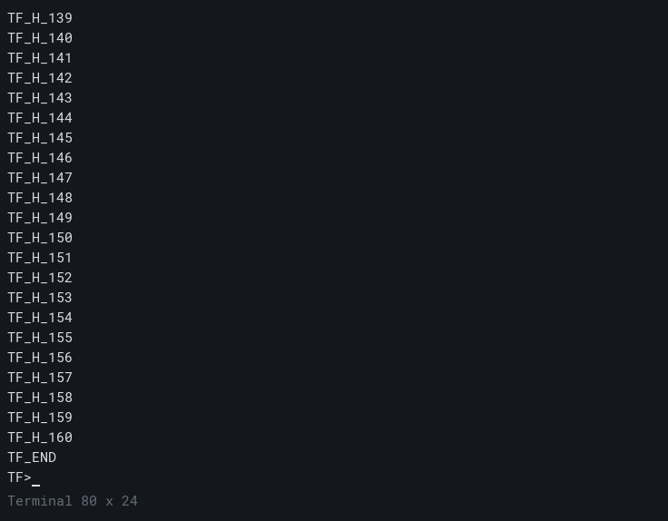
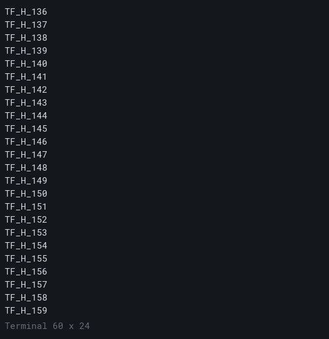
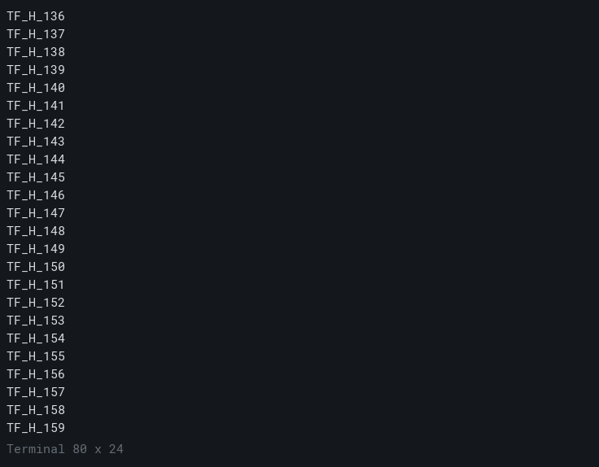

# 正式 Qt：有限历史浏览与源阅读锚点（#29 实现切片 4）

本切片把已确认的 `HistoryViewport` / `TextDocument` / `ViewMapping` 迁移接到**正式 Qt 输入路径**：鼠标滚轮离开底部浏览保留历史，`Ctrl+Shift+Home/End` 到最早/最底，阅读页按当前宽度从同一源锚点有界投影；新输出不移动暂停中的锚点，普通输入回到底部，淘汰/ED3/RIS 使旧锚点失效后钳制到仍保留的最早行并保持暂停。真实 Qt 事件驱动真实 child / 固定 ConPTY 会话；不是物理呈现、滚动条/翻页键历史交互或 WindTerm 行为等价验收。

## 证据来源与最小范围

- 现有明确浏览器行为来自 R1 Win32 历史回归：滚轮/滚动条、`Ctrl+Shift+Home/End`、阅读锚点跨新输出保持、普通输入/开始粘贴回到底部、淘汰钳制到最早行（[R1 foundations](../2026-10-23-r1-foundations/validation.json)）。这是本项目已验收的产品入口行为，不是 WindTerm 原版滚轮/翻页的运行时对照。
- 因此最小端到端范围只纳入有既有证据、且当前 Qt UI 能真实接入的部分：**滚轮浏览**与 `Ctrl+Shift+Home/End`；PageUp/PageDown 继续作为终端应用键发送，滚动条和粘贴入口不在本切片；原版滚轮行数/翻页键映射未追加取证，保持未知。
- 核心复用现有 owner、行 id/version/rank/epoch、有界历史与页投影；没有新增缓存或扫描整段历史。

## 实现

- `TerminalWidget` 新增滚轮处理：累计 `angleDelta` 的整 detent，步长取系统 `QStyleHints::wheelScrollLines()`；非正数回退到 `height-1` 页步长（对应 R1 的 `WHEEL_PAGESCROLL` 规则），余量保留。
- 非跟随状态用 `HistoryViewport::project` 从当前源锚点按当前宽度、最多 200 源行、页高行投影；`ViewMapping`、可见正文和选择命中消费同一页。宽度/高度变化后锚点仍按行身份定位，不按视觉行号。
- `Ctrl+Shift+Home/End` 显式到最早/最底；其他任何普通键在编码前先回到底部再发送。锚点无效（淘汰、ED3、RIS）时 `HistoryViewport` 的有序回退钳制到最早保留行，视图保持暂停直到显式回底。
- 每个 widget 独立 `HistoryViewport`；两个会话互不影响。

## 真实 Qt + 受控 child 回归

`qt_history_navigation`（`src/qt/history_navigation_test.cpp`、`src/qt/history_fixture.hpp`）用真实 child 写 160 行编号日志和一次自发追加，随后接受 `m`（追加）、`3`（ED3）、`r`（RIS）、`q`（退出）。公开 Qt 事件驱动浏览；检查：

- 滚轮离开底部、历史页含旧编号行，页映射 `hit(0,0)` 返回同一源行 id/top；
- 缩窄 60 列、恢复 80 列、缩高/恢复后阅读锚点与源内容前缀保持；
- 阅读中新输出不移动锚点、不替换阅读页；
- `Ctrl+Shift+End` 回底、`Ctrl+Shift+Home` 到最早行；
- 追加导致淘汰时锚点钳制到仍保留最早行且保持暂停；
- ED3 使旧锚点失效，暂停视图钳制到最早行；RIS 同样；
- 普通 Qt 键输入先回底再发送；
- 两个会话隔离（浏览第一个不影响第二个的 following/top）；
- child 自然退出 37、自有 Job 回收通过。

同场景 offscreen 截图（同一构建，`TERMFORGE_TEST_ARTIFACTS` 生成）：

| 底部（最新输出） | 滚轮上翻（阅读历史） |
|---|---|
|  |  |

 为缩窄 60 列后的同一源锚点页； 为阅读期间新输出到达后的页面（锚点不变）。这些是 offscreen 控件抓图，不是物理桌面呈现。

## 验证

- `ctest --test-dir build/qt-cpp -C Release -R '^qt_history_navigation$'`：1/1 通过（约 2.0 s）。
- Qt 正式路径回归 8/8 通过（13.71 s，含新测试）。
- 源码/二进制/截图哈希与构建环境见 [validation.json](validation.json)。

复现：

```powershell
cmake --build build/qt-cpp --config Release --target qt_history_navigation_test --parallel 3
ctest --test-dir build/qt-cpp -C Release -R '^qt_history_navigation$' --output-on-failure
$env:TERMFORGE_TEST_ARTIFACTS = (Resolve-Path experiments/shell/results/2026-11-05-qt-history-anchor/screens).Path
python src/qt/run_smoke.py build/qt-cpp/qt-history-bin/Release/qt_history_navigation_test.exe
```

## 边界与待决项

- 仅单显示器 offscreen、固定 80×24/60×24、短 ASCII 行与有界历史；不覆盖滚动条拖动、翻页键历史浏览、系统粘贴回底、历史浏览中的选择/复制/Find UI、真实呈现/DPI、完整 reflow、Unicode 历史或性能。
- 原版 WindTerm 的滚轮行数、翻页键和阅读锚点行为没有本切片的新运行时取证；当前规则来自 R1 产品合同并明确为项目行为。
- **#317 剩余项仍登记**：旧六阶段 `--resize` 的 native-grid 与保留源寻址取舍未决。需要一个具体产品方案（继续以保留源合同解释 CUP、还是把 native-grid 差异列入已知差异并调整旧判据入口），不能由本历史切片或放任旧失败自行解决；解除条件是该方案及相应旧断言/差异清单变更获用户确认，另附原版中间态证据。旧 `--resize` exit 1 与旧报告保留。
- #27/#29/#30/#7 仍 OPEN；不声明完整历史/选择/Find、WindTerm 等价或 R2 完成。
