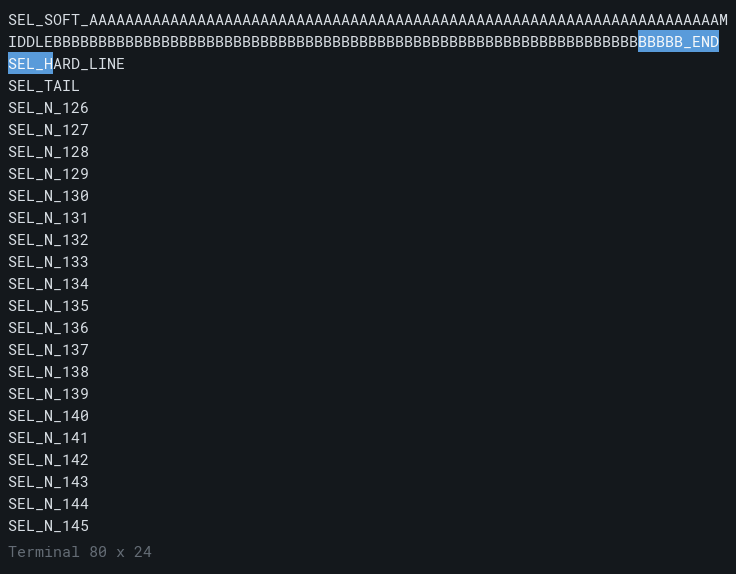

# 正式 Qt：历史/重排页上的选择源位置迁移

本切片关闭 #29 实现方案第 4 片在正式 Qt 用户路径上的选择迁移缺口：在保留历史、软续接和独立显示投影页上，用真实 child 输出与公开 Qt 鼠标/历史浏览入口拖选后，选区仍按源行 ID/version/epoch 投影；显示重排、浏览页变化和无关新输出不改变所选源文本；真实淘汰、ED3、RIS 使锚点失效时明确失效，不就近回退或复活旧内容。只验证内部文本提取与高亮投影，**不冒充系统剪贴板验收**，不新增剪切/粘贴/选词选行/自动滚动/Find UI。

## 实现与闭合路径

- `TerminalWidget` 增加只读/有界诊断接口：`copy_selection(max_bytes)` 走现有 `TextSelection::copy`，`selection_spans()` 返回最近绘制页上的 `ViewMapping::project` 高亮列范围；两者都复用现有 owner、`TextSelection`、`ViewMapping`，未新增内容 owner 或字素规则。
- 没有发现需要改变选择/投影语义的产品缺陷：既有源 ID/version 选择在历史页、软续接、重排和无关输出下保持；因此本切片主要新增真实 Qt + 受控 child 的端到端闭合覆盖和内部提取入口。真实验收仍以测试和字面文本为准。

## 端到端覆盖（`qt_selection_migration`）

真实 child 写入固定合成正文：120 行编号、`SEL_HEAD`、159 字符软续行（`SEL_SOFT_` + 70×`A` + `MIDDLE` + 70×`B` + `_END`）、`SEL_HARD_LINE`、`SEL_TAIL`，再写 40 行使软续行落入有界历史；child 接受 `o`（无关追加）、`a`（淘汰追加）、`3`（ED3）、`r`（RIS）、`q`（退出）。公开 Qt 滚轮进入历史、真实 `QMouseEvent` 正反拖选，检查：

- 反向跨软续行：显示页 row+1 列 20 拖到 row 列 50，内部提取等于源软行 `substr(50,50)`，高亮列数恰 50；
- 部分列 + 硬行边界：软行尾列 70 拖到 `SEL_HARD_LINE` 列 5，文本等于 `soft.substr(150) + "\r\n" + hard.substr(0,5)`，高亮列数 14（不含换行）；
- 显示重排：选区建立后公开 resize 到 `60×20` 再恢复 `80×24`，源文本与高亮仍一致；
- 浏览页变化与无关新输出 `SEL_APPEND` 到达后，源文本不变；
- 真实淘汰（`a` 追加 135 行）后 selection 明确失效，`copy_selection` 非 ok 且文本为空，无邻近复活；
- 淘汰后新选区被 ED3 失效；ED3 后新选区被 RIS 失效；
- 第二会话无泄漏；child 自然退出 37、自有 Job 回收通过。

同场景 offscreen 截图（真实控件抓图，不是物理呈现）：



## RED / GREEN

- 新增测试首次运行在“软续行仍位于活动页”这一**测试夹具布置**上失败（`selection unexpectedly resumed live output`）；修正为在软续行后写入 40 行、使其真正落入历史页后通过。这不是产品选择迁移失败，不能记作产品 RED。
- 修正夹具后，全部断言 GREEN；没有发现需要修改选择/投影语义的产品 RED。此前基础可见页拖选已有覆盖，本切片只新增历史/重排页路径，不重复基础测试。

## 验证

- `ctest -R '^qt_selection_migration$'`：1/1 通过（约 0.9 s）。
- Qt 正式路径回归 9/9 通过（13.31 s）。
- 截图与源码/二进制身份见 [validation.json](validation.json)；无系统剪贴板或物理呈现验收。

复现：

```powershell
cmake --build build/qt-cpp --config Release --target qt_selection_migration_test --parallel 3
ctest --test-dir build/qt-cpp -C Release -R '^qt_selection_migration$' --output-on-failure
$env:TERMFORGE_TEST_ARTIFACTS = (Resolve-Path experiments/shell/results/2026-11-06-qt-selection-migration/screens).Path
python src/qt/run_smoke.py build/qt-cpp/qt-selection-bin/Release/qt_selection_migration_test.exe
```

## 边界

- 单显示器 offscreen、固定短 ASCII 与单一软续行；不覆盖宽字/结合字的选择列映射、真实物理呈现/DPI、系统剪贴板/复制快捷键、粘贴、选词选行、自动滚动、Find 整套 UI、其他尺寸/持续 resize 或性能。
- 内部文本提取与高亮范围不等于系统剪贴板交付；不改变 ADR-0010 已确认方向、旧六阶段 `--resize` 失败、A/B/C 待决或 #27/#29/#30/#7 开放状态。
- 远端取证 VM 几何校准/v2 仍为外部环境阻塞；本切片不依赖它，也不把本结果写成 B/CD 行为验收。
